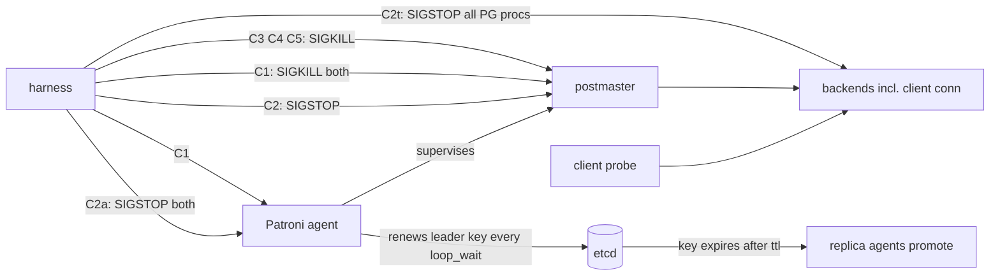

# MEASUREMENTS-ITER2.md — PostgreSQL/Patroni failover lab, iteration 2 (17 Nov 2026)

Build and re-run steps: LAB.md "ITERATION 2". Data: `results/iter2-config-{C1..C5,C2a,C2t}.csv`, phase events `results/iter2-phases-*.csv`, raw per-run logs `runs/iter2-*-rNN/`, per-cell Patroni/etcd logs `runs/iter2-logs/<cell>/`. One host, loopback, one clock, PG 17.12, Patroni 4.1.5, etcd 3.7.3. All runs: 135 briefed (C1–C5) + 20 variant runs (C2a, C2t). No wall-clock shortfall; every cell has its full N.

## Summary (answers to Q1–Q4)
| Q | Answer | Strength |
|---|---|---|
| Q1 agent killed too (C1) | No in-place restart is possible; survivors promote only after the leader key's TTL expires. Client outage **22.4 s median [20.7–27.6]**, 30/30 promotions, ≈4x the pilot's ~6 s. | Established (n=30, log-verified) |
| Q2 SIGSTOP the postmaster (C2) | **Nothing happens.** 15/15 runs: no client error, no leader change, no Patroni log reaction in a 75 s hold. A postmaster-only freeze is not a failure for Patroni or for existing client connections. The TTL-expiry path is only reachable by freezing more: see variants C2a/C2t (promotion at **38.0 s [27.8–40.0]** and **28.1 s [27.6–30.1]**). | C2 established for this fault; variants n=10 each, labelled |
| Q3 tighter timings (C3) | **Yes.** ttl10/loop2/retry3 + PST=0: client outage **1.89 s median [0.19–2.13]** vs pilot A-fo 5.93 s [5.44–7.86]; ranges do not overlap. 30/30 promotions, 0 lost. | Established for this fault on this host |
| Q4 does async lose acked data under lag; does sync prevent it? (C4/C5) | **Async: yes, small.** 6 of 30 runs lost exactly 1 acked transaction (6 total). **Sync: 0 of 30.** One-sided Fisher exact p = 0.012 (6/30 vs 0/30, no multiplicity correction, one host). **But the loss is not caused by the apply-delay lag**: see "What the lag was" below. | Established that the effect exists at this rate; mechanism inferred |

## Diagram: what each fault touches

Walkthrough: the primary's agent keeps the leader key alive in etcd. Kill the postmaster only (C3–C5) and that agent notices and releases the key (fast). Kill the agent too (C1) and nobody releases the key: replicas wait for the TTL. Freeze the postmaster only (C2) and neither the agent nor the client's existing backend notices. Freeze the agent (C2a) and the key expires while the old primary's backends keep serving the client. (Arrow semantics are from Patroni's documented design plus the logs below.)

## Per-cell results (seconds after the fault; median [min–max])
| Metric | C1 kill pm+agent (n=30) | C2 freeze pm (n=15) | C3 tuned (n=30) | C4 async+lag (n=30) | C5 sync+lag (n=30) |
|---|---|---|---|---|---|
| Outcome | 30 promotion | 15 no_effect_observed | 30 promotion | 30 promotion | 30 promotion |
| write_stop_s | 0.000 [−0.004–0.008] | n/a (no failure) | 0.000 [−0.005–0.003] | 0.001 [0.000–0.001] | 0.000 [−0.001–0.001] |
| detect_s | 0.008 [0.005–0.011] | none | 0.007 [0.004–0.010] | 0.004 [0.003–0.008] | 0.004 [0.002–0.011] |
| pg_down_s | 0.058 [0.004–0.100] | none | 0.038 [0.002–0.096] | 0.059 [0.002–0.108] | 0.062 [0.016–0.105] |
| leader_change_s | 22.38 [20.82–27.70] | none | 1.87 [0.20–2.28] | 4.18 [3.23–7.84] | 6.21 [4.72–6.89] |
| primary_ready_s | 22.41 [20.69–27.68] | none | 1.90 [0.17–2.12] | 4.13 [3.22–7.77] | 6.13 [4.83–6.75] |
| **recover_s (client)** | **22.38 [20.67–27.64]** | none | **1.89 [0.19–2.13]** | **4.08 [3.27–7.75]** | **6.13 [4.83–6.72]** |
| acked_total / run | 9025 [8927–9099] | 24068 [23972–24084] | 9031 [8965–9089] | 89052 [73278–90008] | 88749 [68389–89935] |
| acked_lost | 2 total, in 2/30 runs (1 each) | 0 | 0 | 6 total, in 6/30 runs (1 each) | 0 |
| unacked_present | 0 | 0 | 0 | 0 | 7 total, in 7/30 runs |
| error rows / timeout rows | 311 [289–386] / 0 | 0 / 0 | 26.5 [3–31] / 0 | 60.5 [47–113] / 0 | 89.5 [72–98] / 0 |
| settle_s | 41.9 [40.4–47.0] | 90.4 (hold 75 + 15 post) | 17.1 [15.5–17.6] | 19.4 [18.6–23.2] | 21.1 [20.1–22.2] |

`recover_s` is the data of record (client's first commit after its first failure). In C1 `settle_s` includes the harness restarting the killed agent, so it is not a recovery metric.

### Comparison with the pilot (same fault, `kill -9` postmaster, PST=0)
| | median recover_s | range | note |
|---|---|---|---|
| pilot A-fo (async, defaults, pilot workload) | 5.93 | 5.44–7.86 | n=10 |
| **C3** (async, tuned timings, pilot workload) | **1.89** | 0.19–2.13 | n=30 |
| C4 (async, defaults+PST0, heavy workload + lag) | 4.08 | 3.27–7.75 | n=30 |
| pilot B-fo (sync, defaults) | 7.66 | 7.12–7.93 | n=10 |
| C5 (sync, defaults+PST0, heavy workload + lag) | 6.13 | 4.83–6.72 | n=30 |

C4/C5 are ~1.5–1.9 s faster than their pilot counterparts. Config differs only in workload (heavy writes + apply-delay). **Why is not established** (unverified hypotheses: heavier traffic changes how fast the agent's connection to the dead postmaster fails; HA-loop phase). Do not read C3-vs-pilot and C4-vs-pilot as the same kind of comparison: C3 changes timing parameters, C4/C5 change workload.

## Where the time goes (log-verified; medians from `results/iter2-phases-*.csv`, seconds after the fault)
| Event (source: Patroni/PG log lines, ms resolution) | C1 | C3 | C4 | C5 |
|---|---|---|---|---|
| killed node's agent logs crash-failover decision ("Primary crashed"/"Failing over") | n/a (agent dead) | 1.77 | 3.96 | 6.00 |
| "Could not take out TTL lock" (survivor sees key gone) | 22.29 | 1.83 | 4.02 | n/a (not logged) |
| "promoted self to leader by acquiring session lock" | 22.29 | 1.84 | 4.03 | 6.06 |
| PG "received promote request" | 22.30 | 1.85 | 4.03 | 6.06 |
| PG "ready to accept connections" (new primary) | 22.35 | 1.87 | 4.08 | 6.08 |
| client first commit (recover_s) | 22.38 | 1.89 | 4.08 | 6.13 |
| "Assigning synchronous standby" | n/a | n/a | n/a | 7.09 |

Reading it:
- **C3/C4/C5 (kill postmaster):** the decision latency on the killed node's own agent is the whole outage. Decision → promoted ≈ 0.07 s; promote request → ready ≈ 0.02–0.05 s; ready → client commit ≈ 0.02–0.05 s. Promotion mechanics are ≈ 0.1–0.15 s in every cell, same as the pilot. C3 shows the decision latency is set by the HA loop timing (range 0.19–2.13 s fits inside loop_wait=2 s plus slack; inferred from the range, the loop phase itself was not logged).
- **C5 vs C4:** sync adds **+2.0 s median** (6.13 vs 4.08) and the log puts it entirely in the decision step (crash-failover logged at 6.00 vs 3.96 s). Why sync delays the decision is not established. The new sync standby is assigned ≈ 1 s *after* the client already recovered (7.09 vs 6.13).
- **C1 (TTL path):** the survivor logs "Could not take out TTL lock" and "promoted self" in the same millisecond window, i.e. the outage is the leader key's remaining TTL. 20.7–27.6 s is consistent with ttl=30 minus 0–10 s since the dead agent's last refresh (inferred: refresh times were not extracted from the logs). Promotion → ready → client adds ≈ 0.1 s, as before.
- `rewind`, `restart_pg`, `crash_recovery` columns in the phases CSVs are **unvalidated regex matches** (they can catch unrelated lines); not used above.

## Q2 detail: freeze cells
- **C2 (postmaster only), 15/15 `no_effect_observed`.** Client never failed, no leader change, tli unchanged; Run 1's Patroni logs show zero non-routine lines during the 75 s hold. Likely reason (inferred, consistent with the result): a stopped postmaster only blocks *new* connections and child spawning; the probe's and Patroni's existing backend connections keep working.
- **C2a (postmaster + agent frozen), n=10, 10 promotions.** Promotion at **38.0 s [27.8–40.0]**; in 9/10 runs ≈ 38 s, in 1 run 28.0 s. Run 1 log: at +30 s the key expires, both replicas log "following a different leader because i am not the healthiest node" and **drop `primary_conninfo` (WAL streaming stops)**; the winner promotes at +40 s ("promoted self"). The frozen primary's backends keep acknowledging the client the whole time (zombie primary, split brain). Result: **acked_lost median 4,072 per run [max 4,129]** (≈20 s of the pilot's 200 tps; run 6 with the 28 s promotion lost 2,055 ≈ 10 s), about half of it *before* the new leader appears (streaming already stopped) and about half after. The exposure ends only when the harness sends SIGCONT (leader change + 10 s), so the **count is a function of my hold design, not a property of Patroni**; the finding is that an acknowledged-write window of ≈ (promotion − key expiry) + (time until the zombie is fenced) exists, here with no fencing at all.
- **C2t (postmaster + all PG processes frozen, not in the brief), n=10, 10 promotions** at **28.1 s [27.6–30.1]**. The client's INSERT simply blocks in the frozen backend; `statement_timeout` is server-side and `tcp_user_timeout` never fires because the kernel keeps ACKing. **`recover_s` (38.7 s) and `detect_s` for C2a/C2t are set by my SIGCONT (`fail_after_cont` = True 20/20), not by failover**; use `leader_change_s` for these cells. A client with no client-side query timeout would hang indefinitely. acked_lost median 11 per run: commits acknowledged by the resumed old primary before it demoted (11 txns at 200 tps ≈ 55 ms; derived, not measured directly).

## Q4 detail: the lag distribution and what it did
Lag measured on the primary ms before each kill (`pg_stat_replication`), per run, max over the two replicas:
| | C4 async | C5 sync |
|---|---|---|
| replay lag, bytes | min 25.5 MB, p25 28.9 MB, **median 29.1 MB**, p75 29.2 MB, max 29.4 MB | min 24.4 MB, median 28.9 MB, max 29.4 MB |
| replay lag, seconds | 1.84 / 2.46 / **2.69** / 3.10 / 4.77 (min/p25/med/p75/max) | 2.46 / 3.16 / **3.46** / 3.85 / 4.81 |
| **flush (received-but-not-persisted) gap, bytes** | 0 in 21/30 runs; median 0, p75 1,208, max 9,280 | 0 in 19/30 runs; median 0, p75 1,136, max 4,616 |
| acked_lost | 6 txns in 6/30 runs | **0 in 30/30** |
| unacked_present (applied but client saw error) | 0 | 7 txns in 7/30 runs |
| delayed replica became the new primary | 17/30 | 30/30 (by design: it is the sync standby) |

**What the lag was:** the 5 s `recovery_min_apply_delay` delays *replay*, not *receipt*. The delayed replica still receives and flushes WAL immediately, so the loss-relevant gap (flush) was ≈ 0–9 KB, the same as an undelayed replica. Patroni still promoted the delayed replica in 17/30 async runs and 30/30 sync runs with no extra loss: PG replays the already-received WAL on promotion. So the brief's "real lag" is real *replay* lag (≈29 MB, 2–5 s) but it is **not** the mechanism that lost data.
**What lost data:** one transaction, acknowledged by the primary in its last milliseconds, not yet shipped to a replica. 4/6 lossy runs had flush gap 0 at the snapshot (snapshot is ms before the kill), so the snapshot cannot predict which run loses; the loss rate is what's measured. Same mechanism, pilot-workload cells: C1 lost 1 txn in 2/30 runs (the pilot: 0 in 40 runs; C3: 0/30). Pooled async kill cells at the pilot's rate: 2/80 runs with loss (≈2.5%) vs 6/30 (20%) at ~10x write rate (suggestive of scaling with write rate; not tested at intermediate rates).
**Sync:** 0/30 lost, with the same lag. Cost: +2.0 s median recovery vs C4, and 7/30 runs where a commit was applied but unacknowledged (ambiguous-commit direction, not loss).
Not established: data loss under faults that stop WAL *shipping* while the primary keeps acknowledging (partition, walsender stall). C2a is the only cell touching that regime and it is confounded by the zombie.

## Updated verdict: what the candidate paper claim can now say
**Candidate claim (restated):** "Client-observed failover time under Patroni is set by the failed node's agent detection path (not consensus or promotion), depends strongly on fault type and on loop timing; the sync-vs-async trade-off shows up as a small per-kill loss window for async and ≈2 s extra outage for sync."
What iteration 2 supports, on this host:
1. **Fault type dominates, by an order of magnitude** (all `kill`/`stop` of the same primary): postmaster kill ≈ 6 s defaults / 1.9 s tuned; postmaster+agent kill ≈ 22 s (TTL); postmaster-only freeze = no event at all; agent+postmaster freeze = TTL path ≈ 38 s with a zombie primary. (n=30/30/15/10.)
2. **Tuning works for the detection path:** 5.93 → 1.89 s with ttl10/loop2/retry3. Not tested: any false-failover cost of tight timings under a loaded or partitioned system (the thing that normally makes people not do this). Without that, "tune it down" is half a claim.
3. **Async-vs-sync benefit side now has a measurement:** 6/30 vs 0/30 lost acked txns under ~10x write rate for a process kill, +2 s outage for sync. The effect is a *last-milliseconds* window, i.e. it is the async commit window, not the apply-delay lag.
4. **New observation worth a section:** freeze faults produce zombie primaries that keep acknowledging writes while a new leader is promoted (C2a: ≈4,000 lost acks per run, in this setup no fencing; the count scales with hold time and write rate).
Still blocking a paper-grade claim:
- **One host, loopback, one clock, one kernel.** No real network faults (partition, latency, loss), no host loss, no clock skew between client and cluster. The faults here are process-level only. The strongest-looking results (C2a loss, C4 vs C5) are exactly the ones a real network would change.
- **Replication-lag loss is not tested.** Apply-delay gives replay lag, not receive lag; a true shipping gap needs a partition/stall fault or a real network (netem, VMs).
- **Freeze cells' client metrics are artefacts of my hold/SIGCONT design**; a cleaner design needs fencing/STONITH or a bounded client timeout and a pre-registered hold.
- Parameter sweep is one point (ttl10/loop2/retry3); no `synchronous_mode_strict`, no second PG/etcd version; run order was fixed (not randomised); no multiple-comparison correction; spread within a cell is still ≈ loop_wait wide.
- Novelty versus the literature and Patroni's own docs: **unchecked** (no literature search done).

## Limitations and anomalies in this iteration
- C2 as briefed (postmaster-only SIGSTOP) is a null result; C2a/C2t are my additions and are labelled as such. C2a was the brief's "if time allows" variant; C2t is not in the brief.
- **Freeze hold design:** hold until leader change + 10 s (max 75 s), then SIGCONT. All freeze acked_lost counts depend on it.
- Apply-delay had to be set through per-node `patroni.yml` + REST reload (ALTER SYSTEM is wiped by Patroni); in an early smoke test a delay leaked into a later smoke run (smoke data discarded, not in any CSV). The harness now clears delays at the start of every delayed run.
- `iter2-run-2026-11-17.log` contains text I did not write, spliced over part of a C1 run-4 JSON line (lines ≈17–19); cause unknown. CSVs parse cleanly (30/15/30/30/30/10/10 data rows) and per-run raw files are intact; use those.
- Heavy workload achieved ≈1,700 tps probe (target 2,000), i.e. total heavy ≈ 4,000–5,000 tps incl. pgbench vs pilot ≈ 500: "~10x" holds only approximately.
- Pilot kill-cell logs were overwritten; iteration 2 logs are preserved per cell, so C1–C5, C2a, C2t are log-verified. Each cell's logs are in `runs/iter2-logs/<cell>/`.
- No sudo used. Nothing published, pushed or posted. Open-source software only; no employer material.

## Completion note
- **Did:** extended probe (heavy mode) and harness (5 fault types, lag snapshot, apply-delay, outcome classes); ran C1 (30), C2 (15), C3 (30), C4 (30), C5 (30) plus variants C2a (10), C2t (10); per-cell logs preserved; phases extracted; LAB.md updated.
- **Found:** TTL path 22.4 s; postmaster-only freeze is a no-op; tuned timings 1.89 s; async lost 1 acked txn in 6/30 heavy runs vs 0/30 sync (+2 s outage); zombie primary after agent freeze loses thousands of acks.
- **Blocked / not established:** real replication-lag loss, network faults, cause of the C4/C5-vs-pilot speed difference, why sync delays the decision by ≈2 s, unexplained foreign text in the driver log.

ITERATION 2 READY
