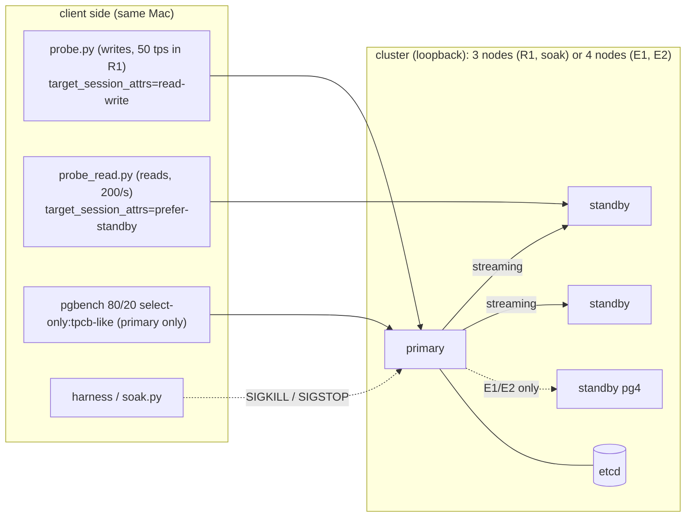

# MEASUREMENTS-ITER4.md — PostgreSQL/Patroni failover lab, iteration 4 (18 Nov 2026)

Scope: Part A (4-node scale check), Part B (read-heavy probe), Part C (2 h soak + regression gate). Part D is `STUDY.md`.
Same host as before: one Mac (macOS 15.5, arm64, 10 cores, 16 GB), loopback, one clock. PG 17.12, Patroni 4.1.5, etcd 3.7.3. No sudo used. Nothing published.
Build: `LAB.md` "ITERATION 4". Data: `results/iter4-config-{E1,E2,E1c,E2c,R1}.csv`, `results/soak-results.csv`; raw per-run files `runs/iter4-<cell>-rNN/`, `runs/iter4-soak/probe.csv`; Patroni/etcd logs `runs/iter4-logs/<cell>/`. Analysis scripts `bin/analyze4.py`, `bin/master_table.py`.

## Summary
| Question | Answer | Strength |
|---|---|---|
| A. Does a 4th node (3 replicas) change detection, convergence or loss for agent death (E1)? | **No change detected.** Client recovery 22.42 s [21.67–27.74] (n=20) vs same-session 3-node control 22.47 s [21.68–27.93] (n=10), permutation p = 0.75. Detection (client sees failure) 0.008 s vs 0.007 s; cluster re-settled 41.9 s in both. Promotion went to every surviving node (pg1/2/3/4 = 3/7/6/4 wins as new primary), so the extra replica took part in elections. | Supported (N=20 vs 10, one host) |
| A. ... for the lag cell (E2: kill postmaster, PST=0, 5 s apply-delay replica, heavy writes)? | **No timing change.** 4.27 s [3.47–7.83] (n=20) vs 3-node control 4.24 s [3.95–7.88] (n=10), p = 0.88; vs iteration-2 C4 (3-node, n=30) 4.08 s, p = 0.16. **Loss:** E2 lost 1 acked txn in 6/20 runs (6 total); control 0/10 (Fisher two-sided p = 0.074); C4 6/30 (p = 0.51). | Timing: supported. Loss: **suggestive at most**, not significant |
| B. Does read load change the outage shape? | **Yes in shape, no in write-path time.** With reads going to a standby (`prefer-standby`), **0 read errors in 20/20 runs** while the write path was down for 22.42 s [21.75–28.08] (n=20; same as the non-read-heavy cell, p = 0.57 vs C1, 0.73 vs E1c). Reads are served throughout; writes are blocked. The probe separates the two paths. | Supported for this fault (agent death) and this reader placement |
| C. Soak gate (12 faults over ~2 h, sync cluster, tuned timings) | **4 of 12 pass.** kill_pm 4/4 pass (outage 0.37–2.17 s); kill_pm_agent 0/4 (19.5–20.1 s); freeze 20 s 0/4 (20.0 s). **Zero acked-lost in 1,323,428 acked txns** (12/12 pass the loss half). Every failure is an outage failure. | Supported as a distribution over 3 fault types x 4 repeats; n per type is small |

## Diagram: iteration-4 additions (what talks to what)

Walkthrough: the write probe and pgbench follow the primary. The read probe prefers a standby, so when the harness kills the primary (dotted arrow) the reader's connection to the standby is untouched; only the write path waits for the leader key to expire and a standby to promote. In E1/E2 a fourth node (pg4, port 5444, REST 8011) is simply another standby candidate. In the soak the harness (`soak.py`) rotates the three faults against the current primary.

## Part A — 4 nodes (1 primary + 3 replicas)
Same native stack, `NNODES=4` in `bin/env.sh` / `lab-up.sh`; harness `bin/run_iter4.py` (= iteration-3 harness, N-node aware, adds `nnodes` column). Health gate requires 4 members streaming with lag 0. Cells E1, E2 as briefed (N=20). **Extra, not briefed:** same-session 3-node controls E1c, E2c (N=10 each) run immediately after, because the iteration-3 review flagged time-separated baselines. Run order: E1, E2, E1c, E2c (fixed, not shuffled).

| Metric (s after fault, median [min–max]) | E1 4-node | E1c 3-node ctl | C1 (iter 2, 3-node) | E2 4-node | E2c 3-node ctl | C4 (iter 2, 3-node) |
|---|---|---|---|---|---|---|
| N / outcome | 20 promotion | 10 promotion | 30 promotion | 20 promotion | 10 promotion | 30 promotion |
| detect_s (client sees failure) | 0.008 [0.003–0.011] | 0.007 [0.006–0.014] | 0.008 [0.005–0.011] | 0.004 [0.003–0.009] | 0.004 [0.003–0.008] | 0.004 [0.003–0.008] |
| pg_down_s | 0.058 [0.005–0.107] | 0.058 [0.029–0.096] | 0.058 [0.004–0.100] | 0.054 [0.006–0.106] | 0.072 [0.016–0.096] | 0.059 [0.002–0.108] |
| leader_change_s | 22.52 [21.65–27.91] | 22.44 [21.74–27.97] | 22.38 [20.82–27.70] | 4.23 [3.21–7.83] | 4.25 [3.95–7.91] | 4.18 [3.23–7.84] |
| **recover_s (client)** | **22.42 [21.67–27.74]** | **22.47 [21.68–27.93]** | 22.38 [20.67–27.64] | **4.27 [3.47–7.83]** | **4.24 [3.95–7.88]** | 4.08 [3.27–7.75] |
| recover_s IQR | 22.33–22.62 | 22.02–22.62 | 22.22–22.53 | 3.94–4.66 | 4.04–4.35 | 3.93–4.35 |
| settle_s (cluster fully healthy) | 41.9 [40.9–46.0] | 41.9 [40.9–47.5] | 41.9 [40.4–47.0] | 19.6 [18.6–23.1] | 19.6 [19.1–23.2] | 19.35 [18.6–23.2] |
| acked_lost | 2 in 2/20 | 1 in 1/10 | 2 in 2/30 | **6 in 6/20** | 0 in 0/10 | 6 in 6/30 |
| acked_lost after leader change | 0 | 0 | 0 | 0 | 0 | 0 |
| new primary | pg1/2/3/4 = 3/7/6/4 | pg1/2/3 = 4/1/5 | pg1/2/3 = 10/12/8 | pg1/2/3/4 = 5/3/5/7 | pg1/2/3 = 2/4/4 | pg1/2/3 = 10/13/7 |

Tests (permutation test on medians, 20,000 shuffles; Fisher exact two-sided; uncorrected for multiple comparisons; `bin/analyze4.py`):
- recover_s: E1 vs E1c p = 0.75 (0.74 excluding each cell's first run); E1 vs C1 p = 0.42; E2 vs E2c p = 0.88; E2 vs C4 p = 0.16.
- Runs with loss: E1 2/20 vs E1c 1/10 p = 1.00; E2 6/20 vs E2c 0/10 p = 0.074; E2 6/20 vs C4 6/30 p = 0.51. Pooled 3-node heavy-async (C4 + E2c): 6/40 = 15%; 4-node E2: 6/20 = 30%.

Reading it:
- **Detection and convergence:** unchanged. The outage is still the leader key's remaining lifetime (E1) or the failed node's own agent decision (E2); a third candidate replica adds no measurable time. Informal sensitivity: the IQRs are ≈0.3 s, so a shift of ≳0.5 s in the median would have shown; I did not compute a formal minimum detectable effect for these n.
- **Loss:** E2's 6/20 is nominally 2x the pooled 3-node rate, but the 3-node control alone had 0/10, so the 3-node rate itself is noisy (0/10 vs 6/30 between two 3-node cells). The loss mechanism is still the last-milliseconds async window (all losses precede the leader change, `acked_lost_after_leader_change` = 0). **Do not read it as "more replicas raise loss"**: not established. A formal power calculation was not done.
- **Not tested:** a sync cell at 4 nodes (only async cells were briefed); multiple sync standbys (`synchronous_node_count > 1`); a 4-node cell with a fault on a replica.
- First runs of each cell include a cold cluster (as in earlier iterations); included in all numbers.

## Part B — read-heavy workload (cell R1)
Workload: write probe 50 tps (`probe.py`) + read probe 200 reads/s (`probe_read.py`: `select max(seq), pg_is_in_recovery(), inet_server_port()` against the probe table; libpq `target_session_attrs=prefer-standby`) = 80% reads / 20% writes at the probe level. Background `pgbench -c4 -R300 -b select-only@4 -b tpcb-like@1` (80/20 by transaction count) against the primary only. Fault: `kill_pm_agent` (SIGKILL postmaster + Patroni agent), async, Patroni defaults, **3 nodes** (Part A had torn down), N=20.

| Metric | R1 read-heavy (n=20) | C1 (iter 2, pilot mix, n=30) | E1c (n=10) |
|---|---|---|---|
| **Write path** recover_s | **22.42 [21.75–28.08]** | 22.38 [20.67–27.64] | 22.47 [21.68–27.93] |
| write detect_s | 0.017 [0.007–0.028] | 0.008 | 0.007 |
| **Read path**: failed reads | **0 in 20/20 runs** (of ≈13,500 reads/run, median) | not measured | not measured |
| read_detect_s / read_recover_s | none / none (no failure to recover from) | | |
| acked_lost (writes) | 0 | 2 in 2/30 | 1 in 1/10 |
| settle_s | 41.9 [40.9–46.5] | 41.9 | 41.9 |

- **Can the probe tell the paths apart? Yes**: separate processes, separate files (`probe.csv` writes, `reads.csv` reads with served port and `in_recovery` flag), analysed separately (`read_*` columns). The write path behaved exactly like the non-read-heavy runs (p = 0.57 vs C1, 0.73 vs E1c); read load on the primary through pgbench did not change write-path recovery.
- **What reads did:** in run 1 the reader sat on pg2 (a standby, `in_recovery=1`) for the whole 22 s outage with max read latency 4 ms, then pg2 itself was promoted and the same connection kept answering (8 reads after promotion reported `in_recovery=0`). In 9 of the 20 runs the reader's standby was the one that promoted, so a few reads at the end of the window were served by the new primary on the same connection; in the other 11 every read in the write-outage window came from a standby. No reconnect was ever needed.
- **Limits, stated plainly:** (1) the reader was never on the failed node, because `prefer-standby` avoids the primary; a design where reads go to the primary (or a replica dies) was not tested. (2) During the outage no new writes commit, so replica reads return unchanged data; **staleness** relative to the lost primary was not measured. (3) Only the agent-death fault was run with read load; the postmaster-kill and freeze faults were not. (4) The read mix goes through a client-side `prefer-standby` policy, not a proxy; a proxy/pooler that routes reads would add its own failure behaviour.

## Part C — soak and regression gate
### The gate (written before the run; identical to the constants in `bin/soak.py` and the 05:13:43 STEPLOG line)
A soak run (one injected fault) **PASSES** iff both hold:
1. **Client outage ≤ 10.0 s.** Outage = the largest gap between consecutive *committed* probe transactions in [fault−1 s, fault+120 s] (catches a client that hangs without any failed attempt, as with a frozen primary; the failure-based `recover_s` is also recorded).
2. **Zero acked-lost** (this is a **sync** cluster, so every acknowledged commit must be present on the final leader after the cluster settles; unacked-but-present rows are recorded, not counted as loss). For an async soak the rule would be "loss recorded, not gated"; **an async soak was not run**.

### Setup
One cluster for the whole run: 3 nodes, `synchronous_mode: true`, `primary_start_timeout=0`, `ttl 10 / loop_wait 2 / retry_timeout 3` (the tuned timings from C3, chosen so that the gate is not trivially failed by the 30 s defaults). One continuous probe, single-row INSERTs at 200 tps, never restarted. No pgbench (it dies with the primary and was not restarted per fault; "steady probe load" is the probe only). 12 faults, one every 600 s (first at +120 s), rotating **kill_pm → kill_pm_agent → freeze → …** (4 of each). *Freeze* = SIGSTOP of the postmaster **and all its children** for 20 s then SIGCONT, with the Patroni agent left running (a postmaster-only freeze had no effect in iteration 2's C2; this is the iteration-2 `stop_pm_tree` shape with a 20 s hold; it is a variant of the brief's "freeze 20 s then thaw"). Before every fault the runner waited for a healthy cluster (3 members streaming, lag 0, sync standby assigned); no fault was delayed (`late_start_s` = 0 in all 12). The killed agent was restarted by the runner after the measured window. Soak ran 05:13 → 07:06 (about 1 h 53 min of fault schedule plus last settle).

### Results (all 12 runs; `results/soak-results.csv`)
| # | Fault | Outage (s) | leader_change (s) | acked lost | Gate |
|---|---|---|---|---|---|
| 1 | kill_pm | 0.91 | 0.91 | 0 | PASS |
| 2 | kill_pm_agent | 20.06 | 20.02 | 0 | FAIL |
| 3 | freeze 20 s | 20.01 | none (same primary) | 0 | FAIL |
| 4 | kill_pm | 0.37 | 0.34 | 0 | PASS |
| 5 | kill_pm_agent | 19.46 | 19.50 | 0 | FAIL |
| 6 | freeze 20 s | 20.02 | none | 0 | FAIL |
| 7 | kill_pm | 2.17 | 2.09 | 0 | PASS |
| 8 | kill_pm_agent | 19.84 | 19.75 | 0 | FAIL |
| 9 | freeze 20 s | 20.01 | none | 0 | FAIL |
| 10 | kill_pm | 2.15 | 2.23 | 0 | PASS |
| 11 | kill_pm_agent | 19.89 | 19.85 | 0 | FAIL |
| 12 | freeze 20 s | 20.01 | none | 0 | FAIL |

Distribution by fault type (outage, median [min–max]): **kill_pm 1.53 s [0.37–2.17], 4/4 pass** · **kill_pm_agent 19.86 s [19.45–20.06], 0/4 pass** · **freeze 20.01 s [20.01–20.02], 0/4 pass**. Overall **4/12 pass (33%)**. Loss half of the gate: **12/12 pass**, 0 acked-lost in **1,323,428** acked transactions across the windows, 0 unacked-present rows. Cluster re-settled in 15.6–18.4 s (kill_pm), 37.9–38.5 s (agent), 65.0–65.1 s (freeze; includes the 20 s hold and the frozen node's catch-up).

What the numbers say, and what they do not:
- **kill_pm (4/4):** same shape as C3 (1.89 s median, n=30), now in a sync cluster: promotion in 0.3–2.2 s, bounded by the 2 s HA loop. Consistent with iteration 2; the sync +2 s cost seen at default timings was not visible here (range 0.37–2.17), unexplained, n=4.
- **kill_pm_agent (0/4):** the survivor logs "promoted self to leader by acquiring session lock" at +19.3 to +20.0 s (log-verified for faults 2 and 5), i.e. leader-key expiry. **With ttl=10 I expected ≈10 s and measured ≈20 s. Why the key outlives the configured ttl is unverified** (I did not read the effective DCS config or the etcd lease TTL during the run). In iteration 2 the same fault at ttl=30 recovered at 22 s, so recovery was ≈20 s at both settings: a signal that the key lifetime is not simply `ttl`, but I did not test other ttl values.
- **freeze (0/4):** the client stalled for the whole 20 s hold and recovered when SIGCONT arrived; **no failover in 4/4 runs** (timeline unchanged, same primary). No client request *failed*; the probe's blocked statement completed after thaw, which is why the outage metric is gap-based. The agent stayed alive and the key did not expire within 20 s. With the 20 s hold equal to the stall, the outcome is a function of my hold choice; a longer hold would trigger a failover (iteration 2 C2t: ≈28 s at ttl 30; not retested at ttl 10).
- **Zero loss in 12 sync faults** matches iteration 2/3 sync cells (C5 0/30, D1 0/30). Nothing here exercises a sync→async degradation.
- **Gate verdict for this configuration:** it passes the loss gate and fails the outage gate for two of three fault types. A real regression gate would be run on the configuration under test and alert on a fault type moving from pass to fail between builds; this soak gives the baseline distribution to compare against.

## Limitations and anomalies
- Single host, loopback, process faults only (no network faults, host loss, clock skew, WAN latency).
- Cells ran in fixed order, not randomised; 3-node controls ran after the 4-node cells in the same session (only ≈1 h apart, not interleaved).
- Soak: n = 4 per fault type; one cluster for the whole run (state carries over between faults, intentionally); sync-only gate; fixed 20 s freeze; no pgbench; rotation order fixed so fault type is confounded with elapsed time (a drift over 2 h would be indistinguishable from a type effect; no obvious drift visible in the repeated outages: 20.06/19.46/19.84/19.89 s).
- Permutation tests uncorrected for multiple comparisons. No formal power calculation.
- Smoke runs (E1, R1 N=1; two 3-fault soaks) were discarded before the real runs; the first smoke soak found that failure-based outage misses a silent stall, which changed the soak's metric before any recorded run.
- `phases3.py` was not run on iteration-4 cells; log reading above is spot checks of soak faults 2 and 5.
- Novelty versus literature/Patroni docs: still unchecked.
- Disk: 20 GiB free at the end (runs/ is ≈0.9 GB).

## Completion note
- **Did:** harness extensions (4-node config, read-heavy probe, soak runner) + `LAB.md` section; E1 20, E2 20, E1c 10, E2c 10, R1 20, soak 12 faults; `STUDY.md`.
- **Found:** 4th node changes nothing measurable on timing; loss difference in E2 not significant; reads survive agent death with 0 errors while writes wait 22 s; soak 4/12 pass, all failures are outage failures on agent-death (≈20 s) and freeze (=hold), zero acked loss in 1.32 M commits.
- **Blocked / not established:** why ttl=10 still gives ≈20 s agent-death recovery; read staleness; reader on the failed node; sync/async soak comparison; whether more replicas change loss (underpowered).

ITERATION 4 READY
