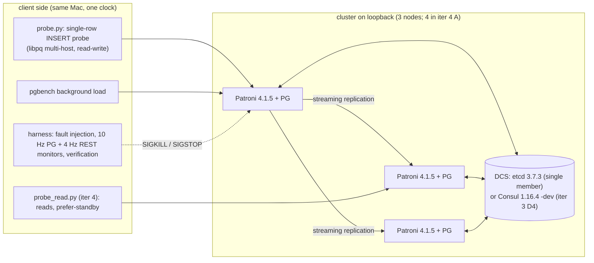

# STUDY.md — PostgreSQL/Patroni failover lab: synthesis of iterations 1–4 (18 Nov 2026)

**INTERNAL DRAFT. Local only. Nothing here is published, deposited or submitted; any release is a later, IP-gated decision.** Open-source software only; no employer material. Every number below is computed from the per-run CSVs in `results/` (`bin/master_table.py`, `bin/analyze4.py`) or taken from the `MEASUREMENTS*.md` files; the ratings are mine and deliberately conservative (they follow the downgrades in `DEBATE-ITER3-AGAINST.md`). Anything unverified is labelled.

## Summary
- 407 fault injections in 4 iterations on one Mac (395 cell runs in 21 cells + 12 soak faults), each measured at the client and each checked for lost acknowledged writes.
- What is solid: with Patroni defaults the outage after a primary failure is set by **when the failed node's Patroni agent (or its leader-key TTL) lets go**, not by promotion (≈0.1 s). Postmaster-only kill: ≈6 s (agent decides) or 1–2 s with tight loop timing; agent also dead: ≈22 s (key expiry). A 4th node, PG16 vs PG17, and a read-heavy mix do not change the timing.
- What a soak adds: a pass/fail distribution. With ttl 10 / loop 2 on a sync cluster, 4/12 faults passed a 10 s outage gate (postmaster kill 4/4; agent death 0/4 ≈19.9 s; 20 s freeze 0/4), with 0 acked-lost in 1.32 M commits.
- What is not established: Consul ≻ etcd, strict-vs-sync, cost of a second fault, "more replicas raise loss", why sync costs +2 s, why ttl=10 still gives ≈20 s agent-death recovery.
- Everything is single-host, loopback, process faults. See "Remaining gaps".

## 1. Methods (iterations 1–4, consolidated)
### 1.1 System under test

Walkthrough: each Patroni agent supervises one Postgres and holds or watches the leader key in the DCS. Clients connect with multi-host libpq (no proxy). The harness injects the fault on the current primary's processes and watches everyone. (Inferred from Patroni docs plus logs: the leader key is what replicas wait on; log-verified for specific cells, see 1.4.)

### 1.2 Stack
| Component | Version / setting | Source of fact |
|---|---|---|
| Host | macOS 15.5, arm64, 10 cores, 16 GB, single host, loopback | `LAB.md` |
| PostgreSQL | 17.12 (iter 1–4); 16.16 for iter 3 D5 | Postgres.app 2.9.7 DMG builds, `LAB.md` |
| Patroni | 4.1.5 (`patroni[etcd3]`), Python 3.9.6 | `LAB.md` |
| DCS | etcd 3.7.3 (single member); Consul 1.16.4 `-dev` single agent in D4 (last MPL-2.0 tag) | `LAB.md`, `STEPLOG.md` |
| Client | psycopg2-binary 2.9.12; `pgbench` from the PG17 bin | `LAB.md` |
| Patroni defaults | ttl 30, loop_wait 10, retry_timeout 10, `maximum_lag_on_failover` 1 MiB; deliberate deviations: `use_pg_rewind`, data checksums, trust auth on 127.0.0.1 | `LAB.md` |
| Cluster modes | async; `synchronous_mode: true` (count 1); `synchronous_mode_strict` (D1 only); `primary_start_timeout` 300 (default) or 0; tuned timings ttl10/loop2/retry3 (C3, soak) | `LAB.md` |

### 1.3 Fault types
| Fault | Action on the primary | Iterations |
|---|---|---|
| `kill_pm` | SIGKILL postmaster only | 1, 2, 3 (D1), 4 (E2) |
| `kill_pm_agent` | SIGKILL postmaster + Patroni agent | 2, 3, 4 |
| `stop_pm` | SIGSTOP postmaster only (hold ≤ 75 s) | 2 |
| `stop_pm_agent` | SIGSTOP postmaster + agent | 2 (variant) |
| `stop_pm_tree` | SIGSTOP postmaster + all its children (agent alive) | 2 (variant); soak "freeze" (20 s hold) |
| `kill_pm_cand` | SIGKILL postmaster, then SIGKILL the candidate's postmaster 2–3 ms after the DCS leader key changes hands | 3 |
| `kill_pm_replica` | same trigger, kills the other replica | 3 |
Run structure: fresh cluster, wait healthy (all members streaming, lag 0, sync standby if sync), create fresh probe table, 30 s steady state, fault, wait for client recovery + 15 s, stop load, wait healthy again, verify every acknowledged seq on the final leader.

### 1.4 Probe design and measurement definitions
- **Write probe** (`probe.py`): one connection, autocommit single-row INSERTs; target 200 tps (pilot), 2000 tps with 1 KB payload (heavy), 50 tps (read-heavy), 100–200 tps (soak). libpq `target_session_attrs=read-write`, `connect_timeout=2`, `tcp_user_timeout=3000`, keepalives 1/1/2, `statement_timeout=3 s`, 50 ms back-off after a failure. Each attempt is logged with start/end epoch (`time.time()`), outcome (committed/error/timeout). *Acked* = server returned COMMIT to the probe.
- **Read probe** (iter 4, `probe_read.py`): 200 reads/s of `max(seq)` + `pg_is_in_recovery()` + `inet_server_port()`, `prefer-standby`; logs the node that served each read.
- **Background load:** pilot `pgbench -c4 -R300` (tpcb-like); heavy `-c8 -R3000` 1 KB inserts; read-heavy select-only:tpcb-like 4:1. pgbench dies with the primary; post-fault load is probe-only.
- **Metrics (seconds after the fault; one host, one clock):** `detect_s` first failed probe attempt; `pg_down_s` first 10 Hz monitor sample with the old primary's port dead; `leader_change_s` first Patroni `/cluster` (4 Hz) leader ≠ old; `primary_ready_s` first sample of a new node out of recovery; **`recover_s` first committed probe txn after the first failure (data of record)**; `max_gap_s` gap between last commit before and first commit after; `acked_lost` acked seqs missing on the final leader (and `…_after_leader_change`); `unacked_present` failed attempts whose row exists; `settle_s` time until the cluster is fully healthy again (includes the harness restarting a killed agent). Soak adds `outage_s` = largest gap between consecutive commits in the fault window (needed because a frozen primary stalls the client without a failed attempt).
- **Caveats on definitions:** for freeze cells (C2, C2a, C2t) `recover_s` is set by the harness's SIGCONT, not by failover (use `leader_change_s`); `phases*.py` regexes `rewind`, `restart_pg`, `crash_recovery` are unvalidated; timing resolution ≈ 50 ms for `recover_s`.
- **Lag setups:** `recovery_min_apply_delay` set per node in `patroni.yml` + REST `/reload` (ALTER SYSTEM does not stick under Patroni); it produces *replay* lag, not receive lag, so it does not itself create a WAL-shipping gap.
- **Log-verified phases:** survivor "promoted self to leader" and PG "ready to accept connections" lines, from preserved Patroni/etcd logs per cell (`runs/iter*-logs/`).

## 2. Master results table (every cell, all iterations)
Median client `recover_s` [min–max] in seconds; `leader_change_s` shown because `recover_s` is harness-driven in freeze cells. Loss = acked transactions absent on the final leader (all losses in non-freeze cells occur before the leader change). Computed by `bin/master_table.py`.

| Iter | Cell | Config | Workload | Fault | N | Outcomes | Median client recover_s [min–max] | Median leader_change_s [min–max] | acked-lost total | runs with loss |
|---|---|---|---|---|---|---|---|---|---|---|
| 1 | A | async, Patroni defaults (PST 300), 3 nodes | pilot | kill_pm | 10 | 10× restart_in_place | 5.96 [4.92–8.28] | n/a | 0 | 0/10 |
| 1 | B | sync, defaults (PST 300), 3 nodes | pilot | kill_pm | 10 | 10× restart_in_place | 5.96 [5.79–8.05] | n/a | 0 | 0/10 |
| 1 | A-fo | async, PST=0, 3 nodes | pilot | kill_pm | 10 | 10× promotion | 5.93 [5.44–7.86] | 6.03 [5.46–7.83] | 0 | 0/10 |
| 1 | B-fo | sync, PST=0, 3 nodes | pilot | kill_pm | 10 | 10× promotion | 7.66 [7.12–7.93] | 7.77 [7.11–8.04] | 0 | 0/10 |
| 2 | C1 | async, defaults, 3 nodes | pilot | kill_pm_agent | 30 | 30× promotion | 22.38 [20.67–27.64] | 22.38 [20.82–27.70] | 2 | 2/30 |
| 2 | C2 | async, defaults, 3 nodes | pilot | stop_pm | 15 | 15× no_effect_observed | n/a | n/a | 0 | 0/15 |
| 2 | C3 | async, PST0 ttl10/loop2/retry3, 3 nodes | pilot | kill_pm | 30 | 30× promotion | 1.89 [0.19–2.13] | 1.87 [0.20–2.28] | 0 | 0/30 |
| 2 | C4 | async, PST0, 5 s apply-delay on 1 random replica, 3 nodes | heavy | kill_pm | 30 | 30× promotion | 4.08 [3.27–7.75] | 4.18 [3.23–7.84] | 6 | 6/30 |
| 2 | C5 | sync, PST0, 5 s apply-delay on sync standby, 3 nodes | heavy | kill_pm | 30 | 30× promotion | 6.13 [4.83–6.72] | 6.21 [4.72–6.89] | 0 | 0/30 |
| 2 | C2a | async, defaults, 3 nodes (variant) | pilot | stop_pm_agent | 10 | 10× promotion | 48.33 [38.20–50.33] | 38.08 [28.02–40.14] | 38751 | 10/10 |
| 2 | C2t | async, defaults, 3 nodes (variant) | pilot | stop_pm_tree | 10 | 10× promotion | 38.69 [38.19–40.73] | 28.31 [27.77–30.19] | 115 | 10/10 |
| 3 | D1 | sync-STRICT, PST0, 5 s apply-delay on sync standby, 3 nodes | heavy | kill_pm | 30 | 30× promotion | 6.02 [4.55–11.46] | 6.05 [4.48–9.25] | 0 | 0/30 |
| 3 | D2 | async, PST0, 3 nodes | pilot | kill_pm_cand | 15 | 15× multi_fault_convergence | 6.03 [5.76–8.69] | 5.87 [5.54–8.02] | 3 | 3/15 |
| 3 | D3 | async, PST0, 3 nodes | pilot | kill_pm_replica | 15 | 15× multi_fault_convergence | 5.75 [5.52–7.94] | 5.83 [5.61–7.91] | 1 | 1/15 |
| 3 | D4 | async, defaults, Consul DCS, 3 nodes | pilot | kill_pm_agent | 30 | 30× promotion | 21.04 [20.12–30.15] | 21.12 [20.11–30.27] | 2 | 2/30 |
| 3 | D5 | async, defaults, PG 16.16, 3 nodes | pilot | kill_pm_agent | 30 | 30× promotion | 22.35 [20.92–28.31] | 22.36 [21.01–28.18] | 1 | 1/30 |
| 4 | E1 | async, defaults, 4 nodes | pilot | kill_pm_agent | 20 | 20× promotion | 22.42 [21.67–27.74] | 22.52 [21.65–27.91] | 2 | 2/20 |
| 4 | E1c | async, defaults, 3 nodes (same-session control) | pilot | kill_pm_agent | 10 | 10× promotion | 22.46 [21.68–27.93] | 22.44 [21.74–27.97] | 1 | 1/10 |
| 4 | E2 | async, PST0, 5 s apply-delay on 1 random replica, 4 nodes | heavy | kill_pm | 20 | 20× promotion | 4.27 [3.47–7.83] | 4.23 [3.21–7.83] | 6 | 6/20 |
| 4 | E2c | async, PST0, 5 s apply-delay, 3 nodes (same-session control) | heavy | kill_pm | 10 | 10× promotion | 4.24 [3.95–7.88] | 4.25 [3.95–7.91] | 0 | 0/10 |
| 4 | R1 | async, defaults, 3 nodes, 80/20 read/write probe | readheavy | kill_pm_agent | 20 | 20× promotion | 22.42 [21.75–28.08] | 22.39 [21.76–28.02] | 0 | 0/20 |

Notes on the table: A/B (pilot) were `restart_in_place`, not promotions. C2 = postmaster-only freeze: no client failure, so no `recover_s`. C2a/C2t `recover_s` and loss are artefacts of my SIGCONT timing (hold design), see claims 15–16. C4/C5/D1/E2/E2c are heavy-write cells with a 5 s apply-delay replica. Soak (12 faults, separate file `results/soak-results.csv`): kill_pm 4/4 pass (outage 0.37–2.17 s), kill_pm_agent 0/4 (19.5–20.1 s), freeze-20s 0/4 (20.0 s); 0 acked-lost of 1,323,428 acked; 4/12 pass the gate.

## 3. Claims table (candidate claims for the benchmark paper)
Rating scale: **established** = replicated across independent cells/iterations, mechanism log-verified, survives the hostile review; **supported** = consistent evidence in at least one well-sized cell, mechanism partly verified or single-iteration; **suggestive** = pattern in the data, under-powered or confounded; **not established** = tested and no support, or untestable with this design.

| # | Claim | Supporting cells | Rating | Why this rating |
|---|---|---|---|---|
| 1 | Under Patroni defaults, killing only the primary's postmaster causes no failover; the agent restarts it in place (≈6 s outage, no loss) | A, B (20/20 restart-in-place) | **supported** | Pilot only, n=10 each; never re-run |
| 2 | With `primary_start_timeout=0`, the same fault becomes a promotion at ≈6 s (async) | A-fo, D1–D3 (≈5.8–6.0 s) | **established** | Several cells agree to ≈0.3 s |
| 3 | Outage is the failed node's agent *decision* latency (≈4–6 s at default loop), not promotion (≈0.1 s) | A-fo, B-fo, C3–C5, D1–D3, E2, E2c; log-verified phases | **established** | Replicated, log-verified timestamps |
| 4 | Tighter HA timing (ttl10/loop2/retry3) cuts postmaster-kill recovery 5.9 s → 1.9 s | C3 (n=30); soak kill_pm 0.4–2.2 s (n=4, sync) | **established** for the fault; false-failover cost untested | Ranges do not overlap; no instability test |
| 5 | If the agent dies with the postmaster, recovery waits for leader-key expiry: ≈22 s at ttl 30 | C1, D5, E1, E1c, R1 (n=30, 30, 20, 10, 20) | **established** | Five cells, medians 22.35–22.47 s, log-verified "promoted self" at key expiry |
| 6 | Agent-death recovery with ttl=10 is still ≈20 s | Soak kill_pm_agent 0/4 (19.5–20.1 s; log: "promoted self" at +19.3–20.0 s) | **suggestive** | n=4, sync, different cluster from C1; cause unverified (effective DCS ttl/lease not read) |
| 7 | A 4th node (3 replicas) changes neither detection, convergence nor recovery time | E1 vs E1c (p=0.75), E2 vs E2c (p=0.88) | **supported** | N=20 vs same-session 10; informal sensitivity ≈0.5 s; async only |
| 8 | A 4th node raises acked loss under async + lag | E2 6/20 vs E2c 0/10 (p=0.074), vs C4 6/30 (p=0.51) | **not established** | Not significant; 3-node cells themselves range 0/10–6/30 |
| 9 | Async can lose the last acked transaction (size 1; 10–30% of heavy runs, ≈5% of agent-death runs); sync lost none | Async: C4 6/30, E2 6/20, E2c 0/10, C1 2/30, E1 2/20, E1c 1/10, D4 2/30, D5 1/30; sync: B 0/10, B-fo 0/10, C5 0/30, D1 0/30, soak 0/12 (1.32 M acked) | **supported** | Direction consistent; Fisher C4 vs C5 p=0.012; all losses precede the leader change; rates vary across cells |
| 10 | `synchronous_mode_strict` differs from plain sync | D1 vs C5 | **not established** | The tested fault cannot separate them; strict's blocking never exercised |
| 11 | Sync costs ≈+2 s outage at default timings | B-fo vs A-fo +1.7 s; C5 vs C4 +2.0 s; D1 vs C4 +1.9 s | **supported** | Three comparisons agree; cause unexplained; not seen at tuned timings (soak, n=4) |
| 12 | A second fault during failover (candidate or other replica) does not prevent convergence | D2 15/15, D3 15/15 | **supported** | One narrow trigger (2–3 ms after key flip); one host |
| 13 | …and adds only ≈0.3 s | D2, D3 vs A-fo | **not established** | No concurrent control; effect below noise |
| 14 | A postmaster-only freeze is invisible to clients and to Patroni | C2 15/15 no effect | **supported** | One iteration, n=15; mechanism inferred |
| 15 | Freezing agent+postmaster creates a zombie primary that keeps acking writes during the key-expiry window | C2a n=10 (median ≈4,070 acked-lost) | **supported** (mechanism); the count is **not** a Patroni property | Count set by my hold/SIGCONT design |
| 16 | A frozen postmaster+children with a live agent stalls clients for the freeze duration; at ttl 10 a 20 s freeze causes no failover | Soak freeze 4/4; C2t (ttl 30: failover ≈28 s) | **supported** | n=4; outcome tied to the 20 s hold; longer hold at ttl 10 untested |
| 17 | PG 16.16 and 17.12 show the same agent-death recovery | D5 vs C1 (p=0.67) | **supported** | Null on a TTL-bound wait (predicted by design); MDE ≈0.25 s |
| 18 | Consul is faster than etcd as the DCS | D4 vs C1 | **not established** | D4 bimodal (24/30 ≈21 s, 6/30 ≈30 s); mean p=0.81; dev-mode single agent; time-separated |
| 19 | Under agent death, standby-served reads see no errors while writes are blocked ≈22 s | R1 (20/20 runs, 0 read errors) | **supported** | One fault; reader never on the failed node; staleness unmeasured |
| 20 | Read-heavy load does not change write-path recovery | R1 vs C1/E1c (p=0.57/0.73) | **supported** | Same caveats; n=20 |
| 21 | A repeated-fault soak yields a pass/fail distribution that separates fault types (gate: outage ≤10 s and zero acked-lost): 4/12 pass; kill_pm 4/4, agent 0/4, freeze 0/4 | Soak (12 faults, ≈2 h) | **supported** as a method demonstration; **suggestive** as a performance claim | n=4 per type, one config, sync only, fixed order |
| 22 | Results generalise to real networks, multiple hosts, WAN | none | **not established** | Out of design (single host, loopback, process faults) |

Tally (22 claims): established 4 (2, 3, 4, 5; claim 4 for its fault only), supported 12 (1, 7, 9, 11, 12, 14, 15, 16, 17, 19, 20, 21), suggestive 1 (6), not established 5 (8, 10, 13, 18, 22).

## 4. Dataset package layout (draft — layout and dictionary only; NOT published)
A local staging build already exists to prove the schema unifies: `dataset-draft/runs_unified.csv` (395 rows × 55 columns, built by `bin/master_table.py`; every `raw_dir` resolves). Nothing leaves this machine.

```
failover-dataset/                      (proposed)
  README.md                            what/why, scope limits, how to cite (TBD, IP-gated)
  LICENSE                              TBD (Sajish's decision; not chosen here)
  DATA_DICTIONARY.md                   the table below, completed
  METHODS.md                           = section 1 of this file
  runs.csv                             one row per fault injection (395 rows so far)
  soak.csv                             one row per soak fault (results/soak-results.csv)
  cells.csv                            one row per cell: config, env knobs, N, fault, dates, harness version
  probes/<cell>/<run>/probe.csv        write attempts: seq,t_start,t_end,outcome,err (raw; runs/ is ≈0.9 GB incl. monitors, compress before any release)
  probes/<cell>/<run>/reads.csv        iteration-4 read attempts (+served_port,in_recovery,max_seq)
  monitors/<cell>/<run>/monitor.csv    10 Hz PG state per node + 4 Hz REST role/state/timeline
  logs/<cell>/                         Patroni, etcd/Consul logs and rendered patroni.yml per node
  code/                                bin/ harness + analysis scripts (versions frozen), env.sh
  checksums.sha256
```
Pre-release checks (all TBD): scrub absolute paths and user names from logs/configs; trust-auth and lab password strings are local-only but still to be reviewed; the lab folder is not under version control, so record a hash of the harness; choose data and code licences separately.

### Data dictionary (draft; `runs.csv`)
| Column | Type | Unit | Definition | Notes |
|---|---|---|---|---|
| iteration | int | | 1–4 | |
| cell | str | | cell label (A, B, A-fo, B-fo, C1…, D1…, E1…, R1) | |
| config_desc | str | | free-text cell config | derive structured columns before release |
| config | str | | label in the original CSV | same as `cell` for iterations 2–4 |
| run | int | | run number within the cell | |
| fault | str | | `kill_pm`, `kill_pm_agent`, `stop_pm`, `stop_pm_agent`, `stop_pm_tree`, `kill_pm_cand`, `kill_pm_replica` | blank in iteration 1, defaulted to `kill_pm` (see `defaulted_fields`) |
| outcome | str | | `promotion`, `restart_in_place`, `no_effect_observed`, `multi_fault_convergence`, `no_recovery` | iteration 1 filled from `failover_type` |
| workload | str | | `pilot`, `heavy`, `readheavy` | |
| nnodes | int | | cluster size | iterations 1–3 defaulted to 3 |
| dcs, pg_version | str | | `etcd`/`consul`; `17`/`16` | defaulted for iterations 1–2 |
| old_primary, new_primary | str | | pg1…pg4 | |
| tli_before, tli_after | int | | PG timeline | |
| kill_epoch | float | s | fault time, Unix epoch, harness clock | later times are relative to this |
| write_stop_s | float | s | end of last commit before first failure − fault | ≈0 |
| detect_s | float | s | first failed probe attempt end − fault | blank if no failure |
| pg_down_s | float | s | first 10 Hz sample with old primary port dead − fault | |
| leader_change_s | float | s | first `/cluster` leader ≠ old − fault | blank for restart-in-place / no change |
| primary_ready_s | float | s | first sample of a new node out of recovery − fault | |
| recover_s | float | s | first commit after first failure − fault | **harness-driven for freeze cells** |
| max_gap_s | float | s | first commit after − last commit before | |
| cont_s, fail_after_cont | float, bool | s | freeze cells: SIGCONT time; was the first failure after it | |
| acked_total | int | txns | acked probe txns in the run | |
| acked_lost | int | txns | acked seqs missing on the final leader | |
| acked_lost_after_leader_change | int | txns | subset acked after the leader change | |
| unacked_present | int | txns | failed attempts whose row exists | ambiguous commits |
| error_rows, timeout_rows | int | rows | failed attempts by type | |
| settle_s | float | s | time to a fully healthy cluster | includes agent restart in agent-kill cells |
| delay_node, lag_flush_bytes_max/min, lag_replay_bytes_max, lag_replay_s_max, lag_json | | bytes, s | apply-delay node and replication-lag snapshot ms before the fault | iterations 2+ |
| trigger_s, trigger_node, trigger_pg_state, second_kill_node, second_kill_s, converged_on, converge_class | | | iteration-3 mid-failover faults | blank elsewhere |
| read_detect_s, read_recover_s, read_errors, read_total, read_on_standby_during | | s, count | iteration-4 read path (R1 only) | `none` = never failed |
| write_recover_s_check | float | s | copy of `recover_s` from the iteration-4 harness | consistency check |
| defaulted_fields | str | | columns filled by the unification script, not by the original harness | provenance |
| raw_dir | str | | relative path of the run's raw files | |
| notes | str | | harness notes | |

`soak.csv` columns: `fault_no, fault, t_fault_epoch, elapsed_min, old_primary, new_primary, outcome (promotion|stall_no_failure|no_recovery|no_client_failure), tli_before, tli_after, leader_change_s, detect_s, recover_s, outage_s (largest commit gap), acked_in_window, acked_lost, unacked_present, settle_s, gate_outage_ok, gate_loss_ok, gate_pass, late_start_s, notes`.
Schema work still needed before any release: separate `fault_end_s` for freeze cells, structured config columns, a host/clock field, and a note that iteration 1 used a different harness file (`run_experiment.py`).

## 5. Paper skeleton
**Working title:** *What decides the outage? Client-observed failover of Patroni-managed PostgreSQL under process faults: a reproducible single-host benchmark.* (Alternatives: "Failover time is a decision-latency problem"; "A regression gate for HA PostgreSQL".)

**Abstract draft (≈150 words; only claims rated established or supported):**
We measure client-observed failover of a Patroni 4.1.5 / PostgreSQL 17 cluster on etcd, injecting 407 process faults (SIGKILL, SIGSTOP) on one host with a continuous write probe that checks every acknowledged commit afterwards. With default settings, killing the primary's postmaster causes no failover; the node's agent restarts it in about 6 s. Forcing a promotion gives the same ≈6 s, of which promotion itself is ≈0.1 s: the outage is the agent's decision latency. When the agent dies too, recovery waits for leader-key expiry, ≈22 s at ttl 30. Cluster size (3 vs 4 nodes), PostgreSQL 16 vs 17, and a read-heavy mix did not change timing; standby reads stayed error-free while writes waited. Asynchronous replication occasionally lost the final acknowledged transaction; synchronous replication lost none in the sync cells we ran. A two-hour soak with a written pass/fail gate shows how such runs yield distributions rather than anecdotes. All limits are single-host.

**Section outline mapped to evidence**
| Section | Content | Evidence |
|---|---|---|
| 1 Introduction | HA Postgres failover is quoted as one number; ask what sets it | motivation only |
| 2 Method | Stack, faults, probe, definitions, verification of acked writes | §1 above, `LAB.md` |
| 3 Where the time goes | Decision latency vs promotion; defaults vs forced promotion; tuned timings | claims 1–4; A, A-fo, C3, phase files |
| 4 Agent death and the key TTL | ≈22 s TTL path; PG16 = PG17; Consul not established (report honestly); ttl=10 open problem | claims 5–6, 17–18; C1, D4, D5, E1, soak |
| 5 Data loss | Async last-transaction window vs sync; strict not established | claims 9–11; C4, C5, D1, E2, soak |
| 6 Scale and workload | 4 nodes; read-heavy; reads survive | claims 7–8, 19–20; E1, E2, R1 |
| 7 Compound and freeze faults | Mid-failover faults converge; freeze variants; zombie primary | claims 12–16; D2, D3, C2, C2a, C2t, soak freeze |
| 8 Soak and regression gating | Gate definition; 12-run distribution; how to gate a release | claim 21; soak |
| 9 Threats to validity | See §6 | gaps list |
| 10 Release | Dataset and harness (decision IP-gated) | §4 |

## 6. Remaining gaps (what a reviewer would still demand)
1. **Second host / real hardware.** Everything shares one CPU, clock and kernel; probe, harness and cluster compete.
2. **Real network faults.** Partitions, packet loss, asymmetric reachability and fencing/split-brain under network loss are untested; process faults do not produce them. The zombie-primary cells (C2a) hint at the exposure but use SIGSTOP.
3. **WAN / latency.** Loopback has ≈0 latency; replication lag, sync-commit cost and DCS round-trip under 1–100 ms+ untested. The +2 s sync cost may change or vanish.
4. **A real multi-node DCS.** Single-member etcd and a single dev-mode Consul: no consensus and no DCS fault.
5. **Strict mode, multiple sync standbys, sync-standby loss.** Untested (claim 10); sync soak only at count 1.
6. **Open why-questions:** why sync adds ≈2 s at default timings but not at tuned ones; why ttl=10 still gives ≈20 s agent-death recovery; the D4 bimodality; the D1 outliers (9.1 s, 11.5 s); cold-start first runs.
7. **Statistics.** Fixed-order cells (no randomisation or interleaving), uncorrected tests, no formal power analysis for loss rates, soak n=4 per fault type, losses are rare events (one txn).
8. **Soak limits:** one config (sync, tuned), no async soak, no pgbench load, fixed 20 s freeze, rotation order confounded with elapsed time, no false-failover (flapping) measurement.
9. **Workload realism.** Single-row inserts and pgbench; no long transactions, big WAL, vacuum/checkpoint pressure, connection pools or proxies (PgBouncer/HAProxy/VIP); read staleness unmeasured; reader never on the failed node.
10. **Other versions and platforms.** One Patroni version, one macOS/arm64 Postgres.app build; no Linux, containers or Kubernetes operators; no comparison with repmgr, Stolon, pg_auto_failover or managed services.
11. **Novelty/literature check** not done (flagged since iteration 1); needed before any contribution claim.
12. **Provenance hygiene:** the lab folder is not under version control; `iter2-run-2026-11-17.log` has unexplained foreign text in lines 17–19 (CSVs and `runs/` are the record).

## Completion note
- **Did:** consolidated methods; master table (21 cells + soak summary); 22-row claims table with conservative ratings; dataset layout and data dictionary (draft; only a local staging CSV exists); paper skeleton with ≈150-word abstract; gaps list.
- **Found:** see Summary. Ratings tally is under the claims table.
- **Blocked / not done:** nothing blocked. No dataset built beyond the local staging CSV; nothing published or deposited; no literature check.
