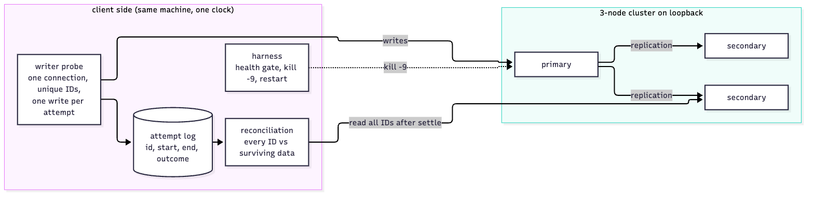

# Client-Observed Write Unavailability After a Primary Process Kill: Five Replicated Database Systems at Shipped Settings on a Single Host

**Sajish Krishnan**
Independent researcher

*Preprint — v2, 21 November 2026. First published 18 November 2026. This version removes a draft header and an internal review note left in v1, renders the method diagram that v1 printed as raw code, and adds an artefact availability section. No data, results or claims are changed.*

---

## Abstract

We measure what a writing client sees when the primary of a three-node database cluster is killed with `kill -9`. Five systems were run on one machine over loopback at their shipped settings: PostgreSQL 17.12 with Patroni 4.1.5, MongoDB 9.0.8 (replica set), MySQL 8.4.13 Group Replication, Redis 8.10.2 with Sentinel, and CockroachDB v26.3.6. A single-writer probe issued uniquely numbered writes, the primary was killed (N=30 per cell), and every write was afterwards reconciled against the surviving data. Median client write outage was 22.38 s for PostgreSQL/Patroni at defaults when the Patroni agent dies with the database, 10.45 s for MongoDB, and 21.49 s for MySQL Group Replication. The PostgreSQL figure was measured with the fault at a near-constant point in the leader's heartbeat cycle; the lease arithmetic gives roughly 20–30 s for a fault at an arbitrary moment, which we did not test. Redis with Sentinel (30.92 s) and CockroachDB (4.27 s stall of the in-flight write) are reported separately because their architectures and the meaning of the measurement differ. In the four primary/replica systems the outage tracks failure-detection or election timing rather than promotion work: PostgreSQL's is the remaining life of a 30 s leader key; MongoDB's is its 10 s election timeout plus a median 0.45 s; Redis's is Sentinel's 30 s down-after setting plus a median 0.92 s; MySQL's is 5.4 s of detection plus a near-constant 16.0 s removal phase we could not attribute to a named parameter. The CockroachDB stall was not decomposed. No timing setting was varied outside PostgreSQL, so that the outage follows these settings is arithmetic, not a tested dependence. For PostgreSQL, a cell with tighter timing settings and a narrower fault recovered in 1.89 s. No acknowledged write was lost in the MongoDB, MySQL or CockroachDB cells, where an acknowledgement already implies a majority and a single process kill cannot be expected to lose one. None was lost in the Redis cell either, where replication is asynchronous and loss was possible in principle but unlikely on loopback: 28 writes across 30 runs were acknowledged within 5 ms of the kill. The PostgreSQL defaults cell, which also replicates asynchronously, lost one acknowledged transaction in each of 2 of 30 runs. All results are single-host, loopback, process-kill results.

---

## 1. Introduction

Failover time for a replicated database is usually quoted as one number. That number hides two questions an operator cares about: how long could a client not write, and what happened to the writes issued around the failure. Both are client-side questions, and both depend on settings the operator may never have chosen.

We ask a narrow version of these questions. Take a three-node cluster as shipped, kill the primary process, and record every write a client attempted. How long is the gap in committed writes, and where does that time go? Which writes were acknowledged and are still there, acknowledged and gone, or reported as failed and yet present?

We ran the same procedure against five systems. PostgreSQL with Patroni was studied in depth first; the other four were run at reference depth with the same probe and ledger discipline. The contribution is modest and specific:

1. A measured client write outage for a primary kill at shipped settings, N=30 per cell, for each system. Secondary-kill controls (N=15) were run for MongoDB, MySQL, Redis and CockroachDB. PostgreSQL, the system studied in most depth, has no such control.
2. For each system, a decomposition of the outage into a detection or election wait and everything else, as far as our instruments and retained logs allow.
3. A full reconciliation of every acknowledged write. For MongoDB, MySQL and Redis the count of writes that were actually at risk is stated next to each zero; for PostgreSQL and CockroachDB only the total acknowledged count is available.
4. Two observations that an error-counting probe would miss: writes that returned an error but had committed, and a MySQL secondary kill that produced no failed write but raised per-commit latency from 1.8 ms to about 247 ms.

The systems are not ranked. The failure unit, the client path, and the meaning of an acknowledgement differ between them, and Section 3 says where.

## 2. Method

### 2.1 Overview

Following the arrows: the harness waits until the cluster passes a health gate, the writer probe sends uniquely identified single-row writes to the current primary and logs every attempt with start time, end time and outcome. The harness kills the primary process. The probe keeps trying. After the measurement window the harness restarts the killed node, waits for the health gate again, and reads the surviving data back from the new primary. Every ID in the attempt log is then classified against that data. The diagram shows the general shape; per-system differences in how the client finds the primary are listed in Table 1.

### 2.2 Environment

All five systems ran on one machine: macOS 15.5, arm64, 10 cores, 16 GB. Every cluster had three data nodes bound to 127.0.0.1. The probe, the harness and the cluster shared the CPU, the kernel and the clock. Measurements were taken on 17 and 18 November 2026.

Settings were left as shipped except for prerequisites needed to form a cluster, which we list per system in Table 1. The one deliberate exception is the PostgreSQL tuned-timing cell, which is labelled as such wherever it appears.

**Table 1. Systems, client paths and probe settings.**

| System | Version and topology | How the client finds the primary | Probe write | Client-side timeouts (instrument settings) | Changes from shipped settings |
|---|---|---|---|---|---|
| PostgreSQL / Patroni | PostgreSQL 17.12, Patroni 4.1.5, single-member etcd 3.7.3; 1 primary + 2 streaming replicas | multi-host libpq string, `target_session_attrs=read-write` | autocommit single-row INSERT, 200/s target, plus `pgbench -c4 -R300` background load | `connect_timeout` 2 s, `statement_timeout` 3 s, 50 ms back-off after a failure | `use_pg_rewind`, data checksums, trust authentication on 127.0.0.1 |
| MongoDB | 9.0.8, replica set of 3 | driver replica-set discovery (pymongo 4.18.3) | `insert_one`, 200/s target, about 100/s achieved | `serverSelectionTimeoutMS` 2000 (driver default 30000) | none |
| MySQL Group Replication | 8.4.13, single-primary group of 3, no Router | probe reads the group view and connects to the ONLINE PRIMARY | autocommit single-row INSERT, 200/s target, about 165/s achieved | 2 s connection timeout, 0.1 s sleep after a failure | Group Replication prerequisites only (server IDs, GTID mode, binary log format, group name and addresses, recovery-channel public-key option) |
| Redis / Sentinel | 8.10.2 core-only source build; 1 primary + 2 replicas + 3 Sentinels, quorum 2 | Sentinel discovery (redis-py 7.0.1), re-resolved on every attempt | `SET`, 200/s | `socket_timeout` 1.0 s | none |
| CockroachDB | v26.3.6, 3 nodes | one fixed surviving gateway node per run, chosen before the fault | autocommit single-row INSERT, 200/s, probe only | `statement_timeout` 3 s plus a 6 s hard per-operation deadline | started with `--insecure` (no TLS, no authentication); cluster settings untouched |

### 2.3 Fault and controls

The fault is `kill -9` of the primary's process, 30 runs per cell. What "the primary's process" means differs:

- **PostgreSQL / Patroni.** A PostgreSQL primary under Patroni is two processes: the postmaster and the Patroni agent that supervises it. Killing only the postmaster at Patroni defaults does not cause a failover; the agent restarts PostgreSQL in place (Section 3.1). The defaults cell reported in the comparison therefore kills the postmaster and the agent together. The tuned-timing cell kills the postmaster only.
- **MongoDB, MySQL, Redis.** One server process per node; the primary's process is killed.
- **CockroachDB.** There is no primary. We kill the whole node process holding the lease for the probe table's range.

Secondary-kill controls (N=15) were run for MongoDB, MySQL, Redis and CockroachDB. No equivalent control was run for PostgreSQL: no PostgreSQL cell kills a replica alone, so the effect of a replica's death on a PostgreSQL client is unmeasured here.

### 2.4 Outcome classes

Every attempt is logged, and a failed ID is never retried by the application (CockroachDB excepted: serialization errors would be retried, and none occurred). After the cluster settles, IDs are classified by reading the data back, never by inference from the attempt log:

- **Acknowledged and present.** The server returned success and the row exists.
- **Acknowledged but lost.** The server returned success and the row is absent from the surviving primary.
- **Committed but unacknowledged.** The attempt returned an error or timed out, and the row exists.
- **Failed.** The attempt returned an error and the row is absent.

Acknowledged IDs were reconciled in every run of every system. Failed IDs were checked against the data for PostgreSQL, CockroachDB and MySQL. They were not checked for MongoDB or Redis, so the committed-but-unacknowledged class is unmeasured for those two.

An acknowledgement does not mean the same thing in each system. At the settings used, a PostgreSQL acknowledgement in the asynchronous cells is a local commit on the primary; a MongoDB acknowledgement is majority-acknowledged with journaling (the server's implicit default write concern was read back as `w: majority`); a MySQL Group Replication acknowledgement follows agreement by a group majority; a CockroachDB acknowledgement requires a Raft quorum; a Redis acknowledgement at `appendonly no` and `min-replicas-to-write 0` means applied in one node's memory.

### 2.5 Metrics

*Client write outage* is the time from the kill to the end of the first committed write that follows the first failed attempt. (The CockroachDB harness computes it as the end of the largest gap between commits that ends after the kill.) In the MongoDB, MySQL, Redis and CockroachDB primary-kill cells the largest gap between consecutive commits agrees with this figure to within about 0.01 s. Timing resolution for the PostgreSQL probe is about 50 ms.

*Acknowledged at risk* is the number of acknowledged writes whose acknowledgement preceded the kill. Writes acknowledged after recovery, on the new primary, cannot be lost to the failover. We report this denominator where the source data provide it, and the count acknowledged within 5 ms of the kill.

Where server logs were retained we split the outage into phases from log timestamps. Where an observer thread polled the cluster for a new primary, we report that time as well.

## 3. Results

### 3.1 PostgreSQL with Patroni

PostgreSQL was studied across more cells than are reported here. Table 2 lists six that isolate a single kill of the primary at light load; further cells with the same fault as the defaults cell are described in the text. Cells with heavier write load, induced replica delay, a second fault or a stop signal instead of a kill are outside this paper; several of them lost acknowledged writes, so the loss counts below are not a bound on asynchronous loss in PostgreSQL.

**Table 2. PostgreSQL / Patroni cells relevant to a primary kill.** Client write outage in seconds after the fault, median [min–max]. All asynchronous replication unless marked.

| Cell | Settings | Fault | N | Outcome | Outage | Acknowledged lost |
|---|---|---|---|---|---|---|
| A | Patroni defaults | kill postmaster | 10 | 10× restart in place | 5.96 [4.92–8.28] | 0 |
| B | defaults, synchronous mode | kill postmaster | 10 | 10× restart in place | 5.96 [5.79–8.05] | 0 |
| A-fo | defaults except `primary_start_timeout=0` | kill postmaster | 10 | 10× promotion | 5.93 [5.44–7.86] | 0 |
| B-fo | as A-fo, synchronous mode | kill postmaster | 10 | 10× promotion | 7.66 [7.12–7.93] | 0 |
| **C1 (defaults cell)** | **Patroni defaults (ttl 30, loop_wait 10, retry_timeout 10)** | **kill postmaster + agent** | **30** | **30× promotion** | **22.38 [20.67–27.64]** | **2, in 2 of 30 runs** |
| **C3 (tuned-timing cell)** | **ttl 10, loop_wait 2, retry_timeout 3, `primary_start_timeout=0`** | **kill postmaster** | **30** | **30× promotion** | **1.89 [0.19–2.13]** | **0** |

**Postmaster kill at defaults is not a failover.** In cells A and B all 20 runs ended with the same node restarting PostgreSQL in place, with a median outage of 5.96 s. The default `primary_start_timeout` of 300 s governs this.

**The defaults cell.** When the agent dies with the postmaster nothing can restart the primary and nothing releases the leader key, so the survivors wait for the key to expire. The median outage was 22.38 s [20.67–27.64]. Log timestamps show where the time goes: a survivor logs that it promoted itself at a median 22.29 s after the kill, PostgreSQL reports ready at 22.35 s, and the client's first commit is at 22.38 s. Promotion and client reconnection together account for about 0.1 s.

Two qualifications apply to the 22.38 s figure. First, key expiry falls at the leader's last heartbeat plus the 30 s ttl, and the harness appears to have injected the fault at a near-constant offset after that heartbeat: about 8.4 s in the runs traced through the logs, which were in a sibling cell with the same fault and settings. In the defaults cell itself, 25 of the 30 runs fell between 21.7 and 22.7 s. The tight clustering is therefore partly a property of the harness. With heartbeats every 10 s, a fault at an arbitrary moment would be expected to give roughly 20–30 s; we did not test this. The first run of the cell, on a cold cluster, took 27.64 s. Second, four further cells with the same fault (PostgreSQL 16.16, a fourth node, a same-session three-node control, and a read-heavy mix) gave medians of 22.35–22.46 s. They share the host, the harness timing and the DCS, so they show robustness to those factors, not independent replication. A fifth cell, with Consul in place of etcd, gave 21.04 s [20.12–30.15] (N=30).

**The tuned-timing cell.** With ttl 10, loop_wait 2, retry_timeout 3 and `primary_start_timeout=0`, a postmaster kill recovered in a median 1.89 s [0.19–2.13]. The killed node's own agent logs its failover decision at a median 1.77 s, a survivor promotes at 1.84 s, and the client commits at 1.89 s.

**Reading the contrast.** The two bold rows differ by a factor of about twelve, and the contrast is real, but it is not a pure timing effect. The cells differ in the fault as well as in the settings: in C1 the agent is dead and recovery waits for key expiry; in C3 the agent is alive and decides for itself. The like-for-like timing comparison is A-fo against C3, the same fault with and without the tighter settings: 5.93 s against 1.89 s, with ranges that do not overlap. For the agent-death fault at tight timings we have only four soak faults on a synchronous cluster at ttl 10, which recovered in 19.46–20.06 s, about twice what key-expiry arithmetic predicts. We have not explained that result, and it means tighter ttl cannot be assumed to shorten the agent-death outage. The possible cost of tight timings, false failovers under load or network trouble, was not tested.

**Writes.** The defaults cell lost one acknowledged transaction in each of 2 of 30 runs, out of 270,676 acknowledged writes in the cell. Replication was asynchronous; the lost transactions were acknowledged before the leader change, consistent with a commit acknowledged by the primary in its last milliseconds and not yet shipped (inferred, not isolated). The tuned-timing cell lost none of 270,941. The sibling cells with the same fault and asynchronous replication lost acknowledged writes at a similar rate: 1 in 1 of 30 runs (PostgreSQL 16.16), 2 in 2 of 20 (fourth node), 1 in 1 of 10 (same-session control), none in 20 (read-heavy mix). Neither Table 3 cell had a write that failed and was later found present. The probe failed fast during the outage: a median 311 failed attempts per run in the defaults cell.

### 3.2 MongoDB replica set

Killing the primary stalled the single-writer `insert_one` stream for a median 10.45 s [10.07–11.41] in 30 of 30 runs. The shipped `electionTimeoutMillis` is 10000. The outage is that timer plus a median residue of 0.45 s [0.07–1.41].

Plainly: the outage is the election time. An observer polling the surviving nodes saw a new writable primary at a median 10.50 s [10.08–11.39]; the client's first commit and the observer's first sighting differ by −0.107 to +0.019 s per run, which is within the observer's roughly 120 ms polling interval. The client adds almost nothing on top of the election. The 0.45 s residue was not decomposed into phases, and cannot be now: the server logs for this cell were not retained.

Client behaviour during the stall is partly a property of our instrument. The probe's 2 s server-selection timeout is shorter than the election, so the driver's single automatic retry of the in-flight insert failed in all 30 runs, and each run shows 4 or 5 failed attempts paced by that timeout (140 in total). At the driver's default of 30 s the client would have seen one long blocked insert instead; we did not run that configuration. The length of the outage does not depend on this setting.

No acknowledged write was lost. Of 73,031 acknowledged writes, 16,131 were acknowledged before the kill and 19 within 5 ms of it. With majority-acknowledged writes, a single process kill is not a fault that can be expected to lose an acknowledged write, so this zero is a check that passed, not a loss-rate estimate. The 30 in-flight inserts that failed at the kill were not checked for unacknowledged commits. The writer achieved about 100 inserts/s.

Killing a secondary (N=15) produced no failed attempt; the largest gap between commits was a median 0.023 s [0.018–0.050]. The victim was the same node in every control run.

### 3.3 MySQL Group Replication

Killing the primary stalled client writes for a median 21.49 s [21.05–22.12] in 30 of 30 runs. In every run the primary role moved to a member other than the one killed. Server logs were retained for all runs and split the outage into three phases:

| Phase (n=30) | Median [min–max] s |
|---|---|
| kill → survivors log the member unreachable | 5.39 [5.01–5.99] |
| unreachable → member removed from the group view | 16.00 [16.00–16.93] |
| removal → probe's first commit | 0.08 [0.02–0.15] |

The run-to-run spread comes almost entirely from the first phase. The second phase is a near-constant 16.0 s. The shipped `group_replication_member_expel_timeout` is 5 s, which does not account for 16 s; we did not identify the source of this phase and did not test it. Nothing was tuned, so it is the behaviour of the system as shipped, but we cannot name the parameter behind it. The third phase bounds what the client path and the default `BEFORE_ON_PRIMARY_FAILOVER` consistency hold contribute together: at most 0.15 s.

The probe failed fast (a median 155 failed attempts per run, 4,640 in total). The error class changes with the phase: connection refused while the survivors still list the dead member as primary, then "no primary" from the probe's own resolver once the member is flagged unreachable. Across the 30 runs the role alternated between the same two members, 15 failovers in each direction; the third member was never elected, and we did not establish why. The cell therefore exercises two of the three possible primaries.

No acknowledged write was lost. Of 18,012 acknowledged writes, 17,432 were acknowledged before the kill and 28 within 5 ms of it. Group Replication agrees a transaction with a group majority before commit, and two of three members survived, so this fault cannot be expected to produce loss; no loss-capable cell was run. Failed IDs were reconciled as well: 3 in-flight writes, one each in three runs, returned a connection error and were present on the new primary.

**Secondary kill: a latency-class result.** Killing a secondary (N=15) produced no failed attempt and no lost write (9,970 acknowledged; 8,738 before the kill). It was not without effect. Per-commit latency rose from a median 1.8 ms before the kill to a median 247 ms after it, in 15 of 15 runs, over 1,233 post-kill commits. Throughput fell from about 165 commits/s to about 4 commits/s for the rest of the 20 s window. The same probe, connection and statement were in use before and after, which excludes the client path as the cause. We infer from timing that commits wait on the dead member until it is removed from the group view; this was not tested directly, and flow-control queues were not sampled during the window. The end of the slowdown was observed once, in a single uncounted diagnostic run with a 45 s window, where it cleared when the survivors logged the member's removal, 21.78 s after the kill. In the 15 counted runs the probe window ended before removal. A probe that counts only errors classifies these runs as unaffected.

### 3.4 Side-by-side summary: PostgreSQL/Patroni with the MongoDB and MySQL reference cells

Table 3 puts the two PostgreSQL cells next to the MongoDB and MySQL primary-kill cells. It is a summary of four cells that share a probe and a ledger method. It is not a ranking and the rows are not like-for-like; the notes below the table are part of the table.

**Table 3. Primary kill: what the outage consists of, and write outcomes.** N=30 per row. Times in seconds, median [min–max]. PostgreSQL rows are in-depth cells; MongoDB and MySQL rows are reference-depth cells (note 1).

| System (cell), depth | Settings | Fault | What the outage consists of | Client write outage | Acknowledged lost / at risk | Committed but unacknowledged | Client behaviour during outage |
|---|---|---|---|---|---|---|---|
| PostgreSQL/Patroni (C1, defaults), in depth | shipped Patroni timings, async | kill postmaster + agent | wait for leader-key expiry (ttl 30) at a near-constant fault phase (note 3); promotion to first commit about 0.1 s | 22.38 [20.67–27.64] | 2 lost, in 2 of 30 runs; 270,676 acknowledged in total, pre-kill count not extracted | 0 | fails fast, median 311 failed attempts per run |
| PostgreSQL/Patroni (C3, tuned timing), in depth | ttl 10, loop_wait 2, retry_timeout 3, `primary_start_timeout=0`, async | kill postmaster only | killed node's agent decides at median 1.77 s; remainder about 0.1 s | 1.89 [0.19–2.13] | 0 lost; 270,941 acknowledged in total, pre-kill count not extracted | 0 | fails fast, median 26.5 failed attempts per run |
| MongoDB (M1), reference | shipped, implicit `w: majority` | kill primary | election timeout 10 s + median 0.45 s residue [0.07–1.41], not decomposed (server logs not retained) | 10.45 [10.07–11.41] | 0 lost in a fault that cannot be expected to produce loss; 16,131 at risk (19 within 5 ms); about 100 writes/s achieved | not checked | 4–5 failed attempts per run, paced by the 2 s instrument timeout; driver retry path untested |
| MySQL Group Replication (G1), reference | shipped plus group prerequisites | kill primary | 5.39 s unreachable detection + 16.00 s removal (unattributed) + 0.08 s to first commit | 21.49 [21.05–22.12] | 0 lost in a fault that cannot be expected to produce loss; 17,432 at risk (28 within 5 ms) | 3 | fails fast, median 155 failed attempts per run |

Notes on Table 3:

1. **This table does not rank the systems.** The MongoDB and MySQL rows are single reference cells at shipped settings: one fault, one configuration, no variation of any setting, no analysis of loss under lag, partitions or second faults. The PostgreSQL rows come from a multi-cell study in which settings and faults were varied. A shorter outage in one row is not evidence that the system fails over faster in general.
2. **The fault is not the same event in each row.** MongoDB and MySQL lose one server process. The PostgreSQL defaults row loses the postmaster and its supervising agent; the tuned row loses the postmaster only. The two PostgreSQL rows therefore differ from each other in fault as well as in settings (Section 3.1).
3. **Read the decomposition column before the outage column.** For MongoDB and MySQL the outage is a fixed wait plus a small residue, and the fixed wait is the finding. The PostgreSQL defaults figure depends on where in the leader's 10 s heartbeat cycle the fault lands; our harness injected it at a near-constant point, and roughly 20–30 s would be expected at an arbitrary one (Section 3.1, untested).
4. **The loss column mixes guarantees and must not be compared across rows.** The PostgreSQL rows replicate asynchronously, so loss is possible and was observed. MongoDB and MySQL acknowledge after majority agreement, so their zero is a check that passed in a fault that could not be expected to produce loss. It is not a loss rate, and it says nothing about either system under a fault that can produce loss.
5. **Client paths and probe settings differ** (Table 1). Failed-attempt counts reflect probe pacing and timeouts, not the systems. The MongoDB client behaviour is a joint property of MongoDB and a 2 s selection timeout that is shorter than the election; at the driver default the client would see one long blocked insert (not run). Background load was present only for PostgreSQL.
6. **The committed-but-unacknowledged column is not comparable either.** It was measured for PostgreSQL and MySQL and not for MongoDB.
7. N=30 supports a median and a range per row, not tail estimates.

**Table 4. Secondary-kill controls (N=15) for the systems of Table 3.** Redis and CockroachDB controls were also run and are reported in Sections 3.5 and 3.6, in keeping with their separation from Table 3.

| System (cell) | Failed attempts | Largest commit gap, median [min–max] s | Acknowledged lost | Note |
|---|---|---|---|---|
| MongoDB (M2) | 0 | 0.023 [0.018–0.050] | 0 of 52,415 | same victim every run |
| MySQL Group Replication (G2) | 0 | 0.25 [0.25–0.26] | 0 of 9,970 | not a null result: per-commit latency 1.8 ms → 247 ms after the kill (Section 3.3) |
| PostgreSQL/Patroni | — | — | — | no secondary-kill control was run; the effect of a replica kill is unmeasured |

### 3.5 Redis with Sentinel

Redis is reported on its own because it is a different class of system from the three above: a key-value store whose acknowledgement, at the shipped `appendonly no` and `min-replicas-to-write 0`, means the write was applied in one node's memory, with failover run by a separate set of Sentinel processes. The probe issues `SET` commands through Sentinel discovery.

Killing the primary stalled writes for a median 30.92 s [30.42–31.45] in 30 of 30 runs. In every run a node other than the killed primary was promoted, and the role rotated across all three nodes. The shipped Sentinel `down-after-milliseconds` is 30000. The outage is that setting plus a median residue of 0.92 s [0.42–1.45] covering election, promotion and client rediscovery. The client's share of the residue is small: the client re-resolves the primary through Sentinel on every attempt, and the first commit after recovery took about 9–11 ms in the runs inspected. The residue was not decomposed further; per-run Sentinel logs were not kept. The client saw failures immediately (first failed attempt a median 0.003 s after the kill) and could not write again until Sentinel acted. The 185,360 failed attempts recorded are writer ticks at 200/s across the outage, not independent evidence. Failed attempts returned in under 30 ms in the runs inspected, which we have not reconciled with the client library's default retry policy.

No acknowledged write was lost. Of 116,541 acknowledged writes, 30,035 were acknowledged before the kill, and 28 of those within 5 ms of it. Redis replication is asynchronous, so loss is a legitimate outcome of a primary failure; a process kill on loopback, with no replica delay, no partition and writes spaced 5 ms apart, could not be expected to produce it. This result does not estimate a loss rate for Redis. Failed IDs were not checked for unacknowledged commits.

Killing a replica (N=15) produced no failed attempt (largest commit gap a median 0.01 s [0.01–0.03]; 0 of 75,775 acknowledged writes lost). The victim was the same replica in every run, so the control shows only that a replica's death does not disturb writes at `min-replicas-to-write 0`.

### 3.6 CockroachDB: a portability observation

CockroachDB is not a primary/replica system: any node accepts SQL and routes to the node holding the lease for the relevant range, and writes are acknowledged after a Raft quorum. We include it briefly as a check that the probe and ledger method ports to such a system, not as a row in the comparison.

We ran the same probe and reconciliation against a three-node CockroachDB v26.3.6 cluster at defaults. With the node holding the probe table's lease killed (N=30), the single in-flight write stalled for a median 4.27 s [3.11–6.08] before writes resumed through a surviving gateway node chosen before the fault. The upper end is capped by our 6 s client deadline, which fired in 4 of the 30 runs. One of the 30 runs was a replacement, executed on a fresh cluster after a harness fault invalidated the original.

This figure is not the same quantity as the outages above. Each run had exactly one failed attempt, and the next attempt committed about 0.07 s after it failed, so the figure is the lifetime of one blocked request. Whether the cluster could have accepted a new write earlier was not sampled. The PostgreSQL probe fails fast and retries hundreds of times through an outage; the CockroachDB gateway holds the one in-flight request. The client also never has to find a new endpoint.

None of 43,688 acknowledged writes was absent afterwards. The more informative result is the ambiguous commit: in 29 of 30 runs the stalled write had committed although the client received an error ("result is ambiguous" in most cases). A client that treats such an error as failure and retries without an idempotency key would write twice. The probe never triggered a serialization retry (SQLSTATE 40001), so that retry path is untested under fault. The breakdown of the stall into its internal phases was not instrumented.

Killing a node that did not hold the lease (N=15) produced no failed attempt (largest commit gap at most 0.07 s; 0 of 22,819 lost). In 12 of those 15 runs the gateway was itself the leaseholder. A further cell that froze the leaseholder for 20 s before killing it produced stalls quantised by the probe's own 3 s statement timeout and is not reported as a measurement.

## 4. Discussion

### 4.1 The outage is a wait, not work

In the four primary/replica systems the client's writes stopped at the kill and the client then waited. In the PostgreSQL, MySQL and Redis cells the first error reached the client within about 0.03 s of the kill; in the MongoDB cell it surfaced only after the probe's 2 s selection timeout. The work of failing over was a small part of the wait wherever we could measure it:

- **PostgreSQL/Patroni.** From a survivor taking the leader lock to the client's first commit was about 0.1 s in both cells. The rest is the wait for the key to expire (defaults cell) or for the failed node's agent to act (tuned cell).
- **MongoDB.** 10 s of the 10.45 s is the election timeout. The residue is a median 0.45 s.
- **MySQL Group Replication.** From removal of the dead member to the client's first commit was a median 0.08 s. The preceding 21.4 s is detection and removal.
- **Redis/Sentinel.** 30 s of the 30.92 s is the down-after setting. The residue, which includes election and promotion, is a median 0.92 s.

For these four systems, then, the median outage after a primary kill is mostly a period in which the cluster has not yet decided the primary is gone.

### 4.2 How far the defaults argument goes

It is tempting to conclude that each outage is simply a shipped default and would move with it. The evidence supports that to different degrees, and we state the degrees.

For MongoDB and Redis the arithmetic is direct: a named setting, read from the running system, accounts for all but a sub-second or roughly one-second residue in 30 of 30 runs. We did not change the setting to confirm that the outage follows it.

For PostgreSQL/Patroni at defaults, log timestamps and the lease arithmetic agree that the outage is the remaining life of a 30 s leader key. PostgreSQL is also the only system where we changed timing settings: for a postmaster kill, tighter settings reduced the outage from 5.93 s to 1.89 s. But the four agent-death faults at ttl 10 still took about 20 s. The simple rule that the outage equals the ttl is therefore incomplete, and the 22.38 s against 1.89 s contrast should be quoted with both the fault and the settings named.

For MySQL Group Replication, the outage is a fixed-looking 16.0 s on top of about 5.4 s of detection. It behaves like a timer. We could not attribute it to a named shipped parameter, and the one obvious candidate, the 5 s expel timeout, does not match. Calling it a default is accurate only in the weak sense that nothing was changed.

For CockroachDB the stall was not decomposed, and we make no claim about what sets it.

The practical reading is narrow: at shipped settings on this host, a client's write outage after a primary process kill ranged from about 10 s to about 31 s across the four primary/replica systems, and in each the dominant term was a detection or election wait that was constant or nearly constant from run to run. Whether shortening those waits is safe is a separate question that this study does not address. Detection timers exist to avoid false failovers on real networks, and we had no network.

### 4.3 What the write ledger adds

Zero acknowledged-but-lost writes is the least informative result here, and we report it with denominators for that reason. In the MongoDB, MySQL and CockroachDB cells the acknowledgement already implies a majority, so a single process kill could not be expected to lose an acknowledged write. In the Redis cell loss was possible in principle and vanishingly unlikely in practice: 28 writes across 30 runs were acknowledged in the last 5 ms before the kill. Among the cells of Table 3 and Sections 3.5 and 3.6, the only one that lost acknowledged writes was PostgreSQL at defaults with asynchronous replication: one transaction in each of 2 runs. Its sibling cells with the same fault lost at a similar rate (Section 3.1).

The class that did appear is the write that failed from the client's point of view and had in fact committed: 29 of 30 in-flight writes in CockroachDB, 3 in MySQL, none in the two PostgreSQL cells of Table 3. It was not checked for MongoDB or Redis. For an application, this class is the one that turns a failover into duplicate writes if errors are retried without idempotency.

### 4.4 Faults an error count does not see

The MySQL secondary-kill control had no failed attempt in any run and would pass any check based on errors. Its commit latency rose by two orders of magnitude for about 20 s. A client-side probe needs to record latency per commit as well as outcome per attempt, or this kind of degradation is recorded as no impact.

## 5. Related work

We have not carried out a systematic literature review, and the sources below concern PostgreSQL failover only; we cite no prior measurements for the other four systems.

Patroni's documentation is the primary source for the timing settings discussed here and their defaults: ttl 30, loop_wait 10, retry_timeout 10 and `primary_start_timeout` 300 s. It gives the worst-case failover time for a primary failure as loop_wait + `primary_start_timeout` + loop_wait [1].

Client-observed Patroni failover has been measured in practitioner reports. Twinhull [2] measured write unavailability through HAProxy on a single setup (Patroni 4.1.5, etcd, PostgreSQL 16) and reports 24–30 s for a hard crash at default timings and 19.9–20.8 s with shortened timings, with no lost writes. Their crash fault kills Patroni and PostgreSQL together, which is the fault of our defaults cell, and their range is of the same order as our figure; the setups differ (theirs adds a proxy and its health checks) and we claim no more than that. The post reports ranges over repeated runs, not medians or a run count. Lluesma [3] reports 135 failover tests: nine routing strategies in front of identical Patroni, Consul and PostgreSQL 18 clusters in Docker, three failure scenarios and five iterations of each. Median client downtime after a hard kill was 21.2–30.8 s across the eight untuned strategies, and 20.0–30.8 s across all nine once an HAProxy variant tuned to ttl 20 is included. The author's reading is that hard crashes land between 20 and 31 s whatever the routing layer, because the 30 s DCS session TTL dominates. Server-side detection and promotion took about 1.1–1.3 s across strategies, a figure the article states for its graceful-stop scenario. These medians are again of the same order as our defaults cell; the setups differ (theirs uses Consul, a routing layer and five runs per cell) and we claim no more than that. A separate practitioner analysis [4] derives a 20–30 s key-expiry window at default settings from the timer arithmetic, depending on where in the renewal cycle the failure falls. It is a model, not a measurement, and agrees with the arithmetic in Section 3.1. Camargos and Augustine [5] describe a set of Patroni fault scenarios for readers to reproduce, including a `kill -9` of the postmaster, without publishing timings.

Sivko [6] reproduced a split brain on CloudNativePG under a network partition and counted acknowledged writes that were afterwards absent or overwritten, using a ledger of acknowledgements kept in a separate database outside the cluster under test. That is the same idea as our reconciliation step, applied to a different operator and a different fault. Jepsen's analyses of PostgreSQL 12.3 [7] and of Amazon RDS for PostgreSQL 17.4 [8] address isolation correctness; neither injects a failover or measures its timing. Earlier academic work includes the DBench-OLTP dependability benchmark of Vieira and Madeira [9] and RemusDB [10], which reports failover within 3 s using virtual-machine replication.

We found no published client-side measurement series for the restart-in-place case of Section 3.1: a postmaster kill with the Patroni agent left alive, at the default `primary_start_timeout`. Of the sources above, [2] kills the agent with the database and does not mention the setting, [3] kills the whole node stack with SIGKILL on a Consul-backed cluster, which is the fault of our defaults cell and not a restart in place, [4] is a model with no runs and does not discuss the case, and [5] lists the postmaster kill as an exercise and reports no result. This is an absence-of-evidence statement from a limited search of practitioner sources, not a claim of priority.

## 6. Limitations

1. **Single machine.** The probe, the harness and all cluster nodes shared one CPU set, one kernel and one clock. Contention between them is uncontrolled.
2. **Loopback networking.** There is no network latency, loss or partition. Replication lag is close to zero, which removes most of the exposure to acknowledged-write loss in asynchronous systems, and detection timers were never exercised against an unreliable network.
3. **Default settings only.** Each system ran as shipped, with the PostgreSQL tuned-timing cell as the one labelled exception. No timing setting was varied for MongoDB, MySQL, Redis or CockroachDB, so the link between a named setting and the outage rests on arithmetic for those systems. Nothing here says what a tuned MongoDB, MySQL, Redis or CockroachDB deployment would do. Version choice was one release per system.
4. **One fault type.** Every fault is a process kill. No partitions, disk faults, clock faults, host loss or quorum loss were tested, and no result here bounds loss under those faults.
5. **N=30 per cell** (15 for controls, 10 for the PostgreSQL pilot cells). Each cell supports a median and a range; tails are not estimated. Cells ran in fixed order without randomisation. For PostgreSQL the fault phase relative to the leader's heartbeat was near-constant, which narrows the observed range.
6. **One client probe pattern.** A single sequential writer issuing small single-row writes at up to 200/s. There were no multi-statement transactions, no contention, no connection pools or proxies, and no MySQL Router. Achieved rates differed (about 100/s for MongoDB, about 165/s for MySQL). Probe timeouts shape the failed-attempt counts and, for CockroachDB, cap the measured stall.
7. **The systems are not measured identically.** The failure unit, the client's path to the primary, the background load (present only for PostgreSQL) and the meaning of an acknowledgement differ. The committed-but-unacknowledged class was not checked for MongoDB or Redis.
8. **Uneven depth.** PostgreSQL has log-verified phases and a settings contrast. MySQL has log-verified phases with one unexplained constant. MongoDB and Redis have timer arithmetic only, because server logs were not retained. CockroachDB has no decomposition. PostgreSQL, the deepest system, is the only one of the five without a secondary-kill control.
9. **Supporting components were minimal.** The Patroni cluster used a single-member etcd, so no failure of the coordination store was exercised.

## 7. Conclusion

On one machine, at shipped settings, killing the primary of a three-node cluster stopped a client's writes for a median 22.38 s in PostgreSQL with Patroni when the agent died with the database (at a near-constant fault phase; roughly 20–30 s would be expected at an arbitrary one), 10.45 s in a MongoDB replica set, 21.49 s in MySQL Group Replication and 30.92 s in Redis with Sentinel; in CockroachDB the in-flight write stalled for a median 4.27 s. In the four primary/replica systems nearly all of that time is a wait for detection or election, and the failover work that follows takes around a tenth of a second where we could measure it, and under 1.5 s where we could only bound it. Two of those waits are named shipped settings (MongoDB's election timeout, Sentinel's down-after period), one is the life of a leader key, and one, in MySQL, is a constant we could not attribute. For PostgreSQL, different settings and a narrower fault gave 1.89 s.

No acknowledged write was lost in the MongoDB, MySQL, Redis or CockroachDB cells, and only in the Redis cell was loss possible in principle. The asynchronous PostgreSQL defaults cell lost two. The more common hazard was the write that reported failure and had committed.

These are loopback, process-kill results. The next steps that would most change what can be claimed are a second host with a real network, a fault that can produce loss in each system reported with its at-risk denominator, and one changed timing setting per system to test whether the outage follows it.

## Artefact availability

The per-cell results data, lab notes and the source of this paper are available at https://github.com/Sajish85/client-observed-write-unavailability and archived on Zenodo under concept DOI 10.5281/zenodo.24359723 (cite the DOI of the specific version you read).

## References

[1] Patroni contributors. "Dynamic Configuration Settings." Patroni documentation. https://patroni.readthedocs.io/en/latest/dynamic_configuration.html

[2] Twinhull. "How long does a Patroni failover take? We measured it." DEV Community, 2026. https://dev.to/twinhull/how-long-does-a-patroni-failover-take-we-measured-it-4g1i

[3] J. Lluesma. "9 PostgreSQL Routing Strategies With Patroni, 135 Failover Tests: Which Patroni Routing Layer Is Actually Fastest?" Medium, 2 May 2026. https://medium.com/@jlluesma85/9-postgresql-routing-strategies-with-patroni-135-failover-tests-which-patroni-routing-layer-is-9d4f4331db5d

[4] "Why Patroni failover takes 26–49 seconds with default settings (and how to make it faster)." DEV Community (account: siemcompliance). https://dev.to/siemcompliance/why-patroni-failover-takes-26-49-seconds-with-default-settings-and-how-to-make-it-faster-h7n

[5] F. Laudares Camargos and J. Augustine. "PostgreSQL HA with Patroni: Your Turn to Test Failure Scenarios." Percona blog, 11 June 2021. https://www.percona.com/blog/postgresql-ha-with-patroni-your-turn-to-test-failure-scenarios/

[6] N. Sivko. "Reproducing split brain on CloudNativePG." Coroot blog, 29 July 2026. https://coroot.com/blog/reproducing-split-brain-on-cloudnativepg/

[7] K. Kingsbury. "PostgreSQL 12.3." Jepsen, 12 June 2020. https://jepsen.io/analyses/postgresql-12.3

[8] K. Kingsbury. "Amazon RDS for PostgreSQL 17.4." Jepsen, 29 April 2025. https://jepsen.io/analyses/amazon-rds-for-postgresql-17.4

[9] M. Vieira and H. Madeira. "A Dependability Benchmark for OLTP Application Environments." Proceedings of the 29th International Conference on Very Large Data Bases (VLDB), 2003, pp. 742–753.

[10] U. F. Minhas, S. Rajagopalan, B. Cully, A. Aboulnaga, K. Salem and A. Warfield. "RemusDB: Transparent High Availability for Database Systems." PVLDB 4(11), 2011.
